<%
	meta("../../meta.json")
	meta()
	const path = require('path');
	url = url + "/posts/" + path.basename(path.dirname(outputPath)) + "/";
%>
<%= render("../../_partials/post-header.html", { title, image, url, description, caption, date, tags, reading_time }) %>

Enumerating a Kubernetes cluster is mostly about not fooling yourself. A port scan hands you numbers like 10250 or 53, and it is tempting to read those as "the kubelet" or "CoreDNS". They are only hints. The same port can belong to two different components, many listeners bind only to loopback, and on a managed cluster half the control plane is simply not visible.

This post is the cheat sheet I use for read-only enumeration: a seven-step loop, every command, and why each one is run. It comes from a 36-slide visual walkthrough of every control-plane and node service, and the slides are at the end of the post. When a step says "slide 3", that is where to look.

<h1 class="toc-header">Table of contents</h1>
<div class="toc">
%%toc%%
</div>

> ⚠️ Authorized targets only. Every command here is read-only: it inspects, it never changes state. Replace `<...>` placeholders and example URLs with your real values.

**The loop, for every component:** 1 Scope → 2 Discover → 3 Inventory → 4 Confirm config → 5 Read-only checks → 6 Record → 7 Correlate

Each step narrows the guess from the step before. A scan gives you a port, the inventory tells you what should be there, the config tells you what really listens, the read-only checks prove it answers, and correlating the layers shows the whole path. Skipping a step is how wrong conclusions happen (slide 3).

## 0 · Setup: the variables used below

The commands below are written once with variables, so you set the real addresses here and every command uses them. Defaults like these URLs are placeholders only (slide 3: defaults are hints).

```bash
NAMESPACE=<namespace>
ETCD_ENDPOINT=https://etcd.example.internal:2379
COMPONENT_URL=https://controller.example.internal:10257
KUBELET_URL=https://node.example.internal:10250
```

- `NAMESPACE`: events and add-on agents live in a namespace; the commands read only that one.
- `ETCD_ENDPOINT`: the real etcd client URL, taken from the API server's `--etcd-servers`, not guessed from port 2379.
- `COMPONENT_URL`: the controller manager, scheduler and cloud controller share one curl pattern; only this URL changes (slide 19).
- `KUBELET_URL`: the kubelet's advertised address and port from the Node object, which may differ from 10250.
- `kapi <path>`: a raw API helper, an authenticated GET against the API server. It shows exactly which API path a `kubectl` command reads. Define it once with `kapi() { kubectl get --raw "$1"; }`.

## 1 · Scope: an authorized host list

You may only test hosts you are allowed to test, and a fixed list keeps every scan inside that boundary.

- **Keep one allowed address per line.** `nmap -iL` reads targets only from this file, so nothing outside it is ever touched.

```bash
cat authorized-hosts.txt
```

## 2 · Discover: scan only the known ports

A scan quickly shows which known listeners answer on which hosts. It is a starting hint for the next steps, not proof of what is running (slide 9).

- **TCP scan of the guide's port list.** `-sT` does a normal TCP connect, `-sV --version-light` adds a quick service guess, and `-p` limits it to the inventory ports (API server, etcd, control plane, kubelet, kube-proxy, DNS diagnostics). Scanning only these avoids touching every NodePort or vendor port.

```bash
nmap -sT -sV --version-light -p 53,80,443,2379,2380,6443,8080,8181,9153,9253,10248,10249,10250,10255,10256,10257,10258,10259 -iL authorized-hosts.txt
```

- **UDP scan of port 53.** Cluster DNS answers mostly over UDP, which a TCP scan cannot see. A UDP scan needs root, hence `sudo`.

```bash
sudo nmap -sU -p 53 -iL authorized-hosts.txt
```

> 💡 **Read the result carefully.** 10250 can be the kubelet or metrics-server, and 53 can be CoreDNS or NodeLocal DNS. A closed or filtered port does not mean the component is absent: it may be loopback-only or on a managed control plane.

## 3 · Inventory: what exists and where

Before checking anything, list what the cluster says it runs. This tells you which components to expect, on which nodes, and stops you from treating an unexpected listener as a known one.

- **Show the active kubeconfig.** Its `server` field is the API server address your tools actually use.

```bash
kubectl config view --minify
```

- **Read the `kubernetes` Service.** It is the in-cluster address that fronts the API server; Pods reach the API through it.

```bash
kubectl get service kubernetes -n default -o yaml
```

- **List kube-system Pods with nodes.** On self-managed clusters the control plane shows up here as mirror Pods, and `-o wide` shows which node each runs on. No control-plane Pods can mean a managed cluster or limited read access.

```bash
kubectl get pods -n kube-system -o wide
```

- **List every DaemonSet.** Node agents (kube-proxy, CNI, CSI, DNS cache, logging, security) run as DaemonSets, so this is the quickest map of what runs on every node.

```bash
kubectl get daemonsets -A -o wide
```

- **Node addresses and advertised kubelet port.** The Node object reports where each kubelet says it listens; you confirm that later in its config.

```bash
kubectl get nodes -o json | jq '.items[] | {name: .metadata.name, addresses: .status.addresses, kubeletEndpoint: .status.daemonEndpoints.kubeletEndpoint}'
```

- **Runtime per node.** The container runtime has no TCP port to scan, so its name and version come from node status.

```bash
kubectl get nodes -o custom-columns='NAME:.metadata.name,RUNTIME:.status.nodeInfo.containerRuntimeVersion'
```

- **Provider ID per node.** A provider ID shows the nodes were registered by a cloud controller, which is better evidence of the cloud than a Pod name.

```bash
kubectl get nodes -o custom-columns='NAME:.metadata.name,PROVIDER:.spec.providerID'
```

- **CSI nodes and drivers.** Storage drivers use local Unix sockets, so the API is where you see which drivers are registered on which nodes.

```bash
kubectl get csinodes,csidrivers
```

- **API resources.** CNI and other plugins add their own API groups, which reveal the plugin even when no port identifies it.

```bash
kubectl api-resources -o wide
```

- **Leases in kube-system.** The controller manager, scheduler and cloud controller elect a leader through a Lease; this shows which replica is currently active.

```bash
kubectl get leases.coordination.k8s.io -n kube-system
```

## 4 · Confirm config: the real bind address, port, TLS and auth

Ports are only defaults. The manifest, flags and config files say what really listens, on which address, with which TLS and authentication. This is the evidence the scan cannot give you.

**Control plane (self-managed):**

- **API server Pod spec.** The command line in the mirror Pod holds its flags: bind address, secure port, authorization, admission, audit and etcd endpoints.

```bash
kubectl get pod <apiserver-pod> -n kube-system -o yaml
```

- **Controller manager, scheduler and cloud controller Pod specs.** Each spec shows its secure port, bind settings, kubeconfig reference and leader-election config, so you know the real listener before probing it.

```bash
kubectl get pod <controller-manager-pod> -n kube-system -o yaml
kubectl get pod <scheduler-pod> -n kube-system -o yaml
kubectl get pod <ccm-pod> -n kube-system -o yaml
```

- **The static manifest on the host.** It is the source the kubelet starts the API server from, so it is the authoritative config. `/etc/kubernetes/manifests` is the usual kubeadm path, but the kubelet config decides the real one.

```bash
sed -n '1,240p' /etc/kubernetes/manifests/kube-apiserver.yaml
```

**Record from the API server.** These settings decide who can reach it and what it trusts: `--bind-address`, `--secure-port`, authorization mode and order, auth issuers and audiences, admission plugins, audit, ServiceAccount issuer, `--etcd-servers` and etcd TLS, encryption-provider config.

**Nodes:**

- **Listening sockets with process.** Shows what really listens on this host and which process owns it, which is the only way to confirm loopback-only ports. `ss -lntup` adds UDP.

```bash
ss -lntp
```

- **How the kubelet is started.** The service unit shows the kubelet's flags and which config file it loads (commonly `/var/lib/kubelet/config.yaml`). That file holds the address, ports, auth, staticPodPath and runtime endpoint.

```bash
systemctl cat kubelet
```

- **kube-proxy DaemonSet and ConfigMap.** They show the intended proxy mode and its health and metrics bind addresses. A CNI can replace kube-proxy, so check it exists.

```bash
kubectl get daemonset kube-proxy -n kube-system -o yaml
kubectl get configmap kube-proxy -n kube-system -o yaml
```

- **CNI config directory.** Shows which network plugin the node really uses, since no universal port identifies one.

```bash
ls /etc/cni/net.d
```

- **Kubelet plugin directories.** CSI drivers, device plugins and the PodResources socket register here as local Unix sockets, invisible to any network scan.

```bash
ls /var/lib/kubelet/plugins_registry /var/lib/kubelet/device-plugins /var/lib/kubelet/pod-resources
```

**Add-ons:**

- **DNS Service and its EndpointSlices.** The Service gives the cluster DNS IP (often named `kube-dns` even with CoreDNS) and the EndpointSlices show which Pods actually serve it.

```bash
kubectl get service kube-dns -n kube-system -o yaml
kubectl get endpointslices -n kube-system -l kubernetes.io/service-name=kube-dns
```

- **CoreDNS Corefile and Deployment.** The Corefile says which plugins are on, which decides whether the 8080, 8181 and 9153 diagnostic ports exist at all.

```bash
kubectl get configmap coredns -n kube-system -o yaml
kubectl get deployment coredns -n kube-system -o yaml
```

- **NodeLocal DNS DaemonSet and ConfigMap.** They show the node-local listener IP, host networking and the upstream forward targets.

```bash
kubectl get daemonset node-local-dns -n kube-system -o yaml
kubectl get configmap node-local-dns -n kube-system -o yaml
```

- **Metrics server APIService, Deployment and Service.** Metrics-server is reached through the API server, so the APIService shows the routing, and the Deployment and Service show its secure port and targetPort (upstream 10250, which is why it can look like a kubelet).

```bash
kubectl get apiservice v1beta1.metrics.k8s.io -o yaml
kubectl get deployment metrics-server -n kube-system -o yaml
kubectl get service metrics-server -n kube-system -o yaml
```

## 5 · Read-only checks: health, version, status, metrics

Now that you know the real listener, a GET to its health, version or metrics URL proves it is the component you think it is and shows whether it is healthy, without changing anything.

**API server:**

- **Version.** Identifies the API server and its exact Kubernetes version.

```bash
kubectl get --raw /version
```

- **Readiness and liveness, per check.** `?verbose` lists every internal check, so a single failing one (etcd, informers, webhooks) stands out.

```bash
kubectl get --raw '/readyz?verbose'
kapi '/livez?verbose'
```

- **API discovery.** Lists the core and named API groups the server advertises, which also reveals installed extensions.

```bash
kapi /api
kapi /apis
```

**etcd** (with the designated etcd diagnostic client certificate):

- **Health over mutual TLS.** Etcd requires a client certificate signed by the etcd CA; this proves the member answers and is healthy without reading any cluster data.

```bash
curl --cacert /path/to/etcd-ca.crt --cert /path/to/etcd-client.crt --key /path/to/etcd-client.key "$ETCD_ENDPOINT/health"
```

- **Endpoint status table.** Shows member version, leader, revision and errors in one table, again without dumping key/value data.

```bash
etcdctl --endpoints="$ETCD_ENDPOINT" --cacert=/path/to/etcd-ca.crt --cert=/path/to/etcd-client.crt --key=/path/to/etcd-client.key endpoint status -w table
```

**Controller manager 10257 / scheduler 10259 / cloud controller 10258:**

- **Health and metrics with a client certificate.** These components accept a designated client certificate on their HTTPS port; `/healthz` confirms it is alive and `/metrics` confirms its identity and activity. A kubeconfig token is not accepted by every component.

```bash
curl --cacert /path/to/component-ca.crt --cert /path/to/diagnostic-client.crt --key /path/to/diagnostic-client.key "$COMPONENT_URL/healthz"
curl --cacert /path/to/component-ca.crt --cert /path/to/diagnostic-client.crt --key /path/to/diagnostic-client.key "$COMPONENT_URL/metrics"
```

- **FailedScheduling events.** Shows why Pods are Pending, which separates a scheduling constraint from a failing scheduler.

```bash
kubectl get events -n "$NAMESPACE" --field-selector reason=FailedScheduling
```

**kubelet:**

- **Local health on the node.** 10248 is a plain HTTP health port bound locally, so it confirms the kubelet is alive without certificates.

```bash
curl --fail http://127.0.0.1:10248/healthz
```

- **Authenticated health, Pods and metrics.** The HTTPS port 10250 needs a client certificate; `/healthz` proves identity, `/pods` shows the kubelet's own view of its Pods (not the same as reading Pods through the API server), and `/metrics` shows its activity. Each path has different authorization.

```bash
curl --cacert /path/to/kubelet-ca.crt --cert /path/to/diagnostic-client.crt --key /path/to/diagnostic-client.key "$KUBELET_URL/healthz"
curl --cacert /path/to/kubelet-ca.crt --cert /path/to/diagnostic-client.crt --key /path/to/diagnostic-client.key "$KUBELET_URL/pods"
curl --cacert /path/to/kubelet-ca.crt --cert /path/to/diagnostic-client.crt --key /path/to/diagnostic-client.key "$KUBELET_URL/metrics"
```

**kube-proxy and the runtime** (on the node):

- **kube-proxy health and metrics.** 10256 confirms kube-proxy is serving, and 10249 (usually loopback only, so run on the node) shows its metrics.

```bash
curl --fail http://127.0.0.1:10256/healthz
curl --fail http://127.0.0.1:10249/metrics
```

- **Runtime info, Pod sandboxes and containers.** The runtime only listens on a Unix socket, so `crictl` on the node is how you see it. These commands only list; they never start containers or run commands in them.

```bash
crictl --runtime-endpoint unix:///run/containerd/containerd.sock info
crictl --runtime-endpoint unix:///run/containerd/containerd.sock pods
crictl --runtime-endpoint unix:///run/containerd/containerd.sock ps -a
```

**DNS and metrics:**

- **The resolver a Pod uses.** Shows which DNS IP Pods really query: the cluster DNS Service, or a NodeLocal cache.

```bash
cat /etc/resolv.conf
```

- **Resolve a known cluster name.** `kubernetes.default.svc` always exists, so a correct answer proves that resolver works, through CoreDNS or through NodeLocal DNS.

```bash
dig @<dns-ip> kubernetes.default.svc.<cluster-domain> A
dig @<node-local-ip> kubernetes.default.svc.<cluster-domain> A
```

- **CoreDNS health, readiness and metrics.** Confirms the diagnostic plugins are on and the Pod is healthy. Run them only if the Corefile enables these plugins, and against the Pod address, because the DNS Service may not expose these ports.

```bash
curl --fail --max-time 10 http://<pod-ip>:8080/health
curl --fail --max-time 10 http://<pod-ip>:8181/ready
curl --fail --max-time 10 http://<pod-ip>:9153/metrics
```

- **NodeLocal DNS metrics.** Confirms the node cache is running at its bind IP (9253 comes from the example manifest, so confirm it first).

```bash
curl --fail --max-time 10 http://<bind-ip>:9253/metrics
```

- **Node metrics through the API server.** `kubectl top` tests the whole path (API server, APIService, metrics-server, kubelets) end to end; the raw read shows the aggregated API directly.

```bash
kubectl top nodes
kapi /apis/metrics.k8s.io/v1beta1/nodes
```

## 6 · Record: what to write down

Enumeration is only useful if someone else can check it. Write down what you saw, exactly where you saw it.

| Item | What it tells you |
|---|---|
| Version | Per component and per replica you reached: one healthy answer behind a load balancer does not describe every replica |
| Endpoint | The exact address and port you contacted, so the result can be repeated |
| Leader state | Which replica holds the Lease is the one actually doing the work |
| Errors | Readiness failures, health errors and scheduling failures point to real problems |
| 401 / 403 | Reachable but not authorized is a result. It is not a reason to switch identity |
| Secrets | Record key and file paths only, never their contents |

## 7 · Correlate: join the layers

Each layer only shows part of the truth. Joining Services, EndpointSlices and the node's real forwarding rules shows how traffic actually flows.

- **Node addresses and routes.** Shows the node's interfaces and routing, the base the forwarding rules sit on.

```bash
ip -brief address
ip route show
```

- **The forwarding rules for the installed proxy mode.** The ConfigMap only says the intended mode; these show the real dataplane. Run only the one that matches the mode, since some modes show no listener in `ss` at all.

```bash
iptables-save
nft list ruleset
ipvsadm -Ln
```

- **Match Service IP and port plus EndpointSlice backends to those rules.** Proves a Service really forwards to the Pods it claims.
- **Match Pod UID and sandbox or container IDs from crictl to Pod status.** Proves the runtime runs what Kubernetes thinks it runs.
- **Match a NetworkPolicy object to the installed dataplane.** A policy in the API alone does not prove the network plugin enforces it.

## Port quick reference

A one-glance list of the defaults to look for. They are hints, so always confirm the real listener from config.

| Port | Component |
|---|---|
| 6443 | kube-apiserver (frontends often 443) |
| 2379 / 2380 | etcd client / peer |
| 10257 | kube-controller-manager |
| 10259 | kube-scheduler |
| 10258 | cloud-controller-manager |
| 10250 | kubelet HTTPS (also metrics-server upstream) |
| 10248 | kubelet local health |
| 10255 | kubelet legacy read-only, normally off |
| 10256 / 10249 | kube-proxy health / metrics |
| 53 | CoreDNS, NodeLocal DNS (UDP/TCP) |
| 9153, 8080, 8181 | CoreDNS metrics, health, ready (if enabled) |
| 9253 | NodeLocal DNS metrics (example manifest) |
| 30000-32767 | NodePort range |
| Unix socket | Container runtime, CSI, device plugins (no TCP scan) |

## The slide deck

The full walkthrough in five parts: overview and ports (1-9), control-plane services (10-19), node services (20-27), shared add-ons (28-33) and the wrap-up (34-36). Click a slide to open it full size.

<div class="slide-gallery">
<a href="media/slide-01.webp" title="Slide 1: Cover: Kubernetes Enumeration">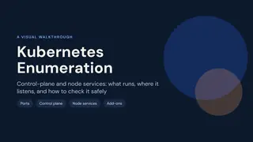</a>
<a href="media/slide-02.webp" title="Slide 2: What this guide is for">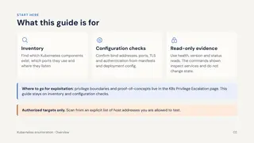</a>
<a href="media/slide-03.webp" title="Slide 3: Four rules that prevent wrong conclusions">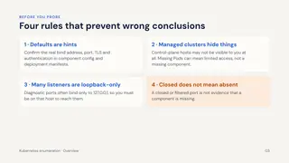</a>
<a href="media/slide-04.webp" title="Slide 4: Where each component lives">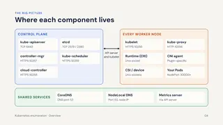</a>
<a href="media/slide-05.webp" title="Slide 5: Port inventory 1 of 3: Control-plane ports">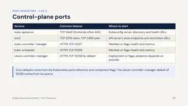</a>
<a href="media/slide-06.webp" title="Slide 6: Port inventory 2 of 3: Node ports">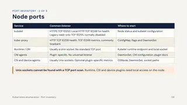</a>
<a href="media/slide-07.webp" title="Slide 7: Port inventory 3 of 3: Shared services and app exposure">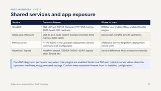</a>
<a href="media/slide-08.webp" title="Slide 8: Discovery: Scan only an authorized host list">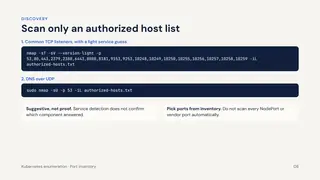</a>
<a href="media/slide-09.webp" title="Slide 9: Common trap: A port is a listener, not an identity">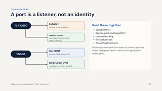</a>
<a href="media/slide-10.webp" title="Slide 10: Part 2: Control-plane services">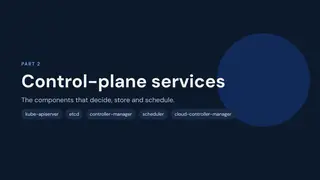</a>
<a href="media/slide-11.webp" title="Slide 11: kube-apiserver 1 of 3: Find the endpoint and identify it">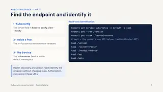</a>
<a href="media/slide-12.webp" title="Slide 12: kube-apiserver 2 of 3: Self-managed: read its configuration">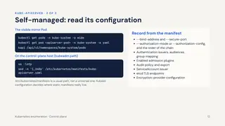</a>
<a href="media/slide-13.webp" title="Slide 13: kube-apiserver 3 of 3: Evidence and pitfalls">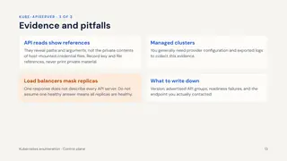</a>
<a href="media/slide-14.webp" title="Slide 14: etcd 1 of 2: Two listeners with different jobs">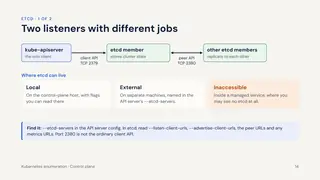</a>
<a href="media/slide-15.webp" title="Slide 15: etcd 2 of 2: Check health and status safely">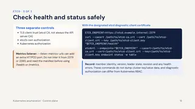</a>
<a href="media/slide-16.webp" title="Slide 16: kube-controller-manager · HTTPS 10257">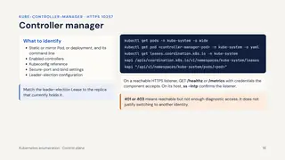</a>
<a href="media/slide-17.webp" title="Slide 17: kube-scheduler · HTTPS 10259">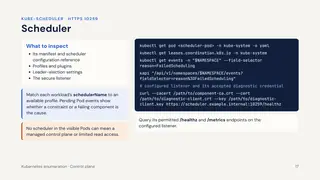</a>
<a href="media/slide-18.webp" title="Slide 18: cloud-controller-manager · HTTPS 10258 by default">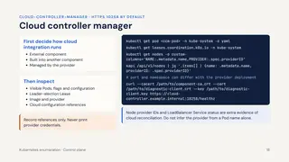</a>
<a href="media/slide-19.webp" title="Slide 19: Shared pattern: Authenticated component diagnostics">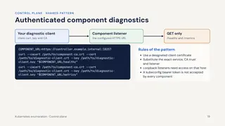</a>
<a href="media/slide-20.webp" title="Slide 20: Part 3: Node services">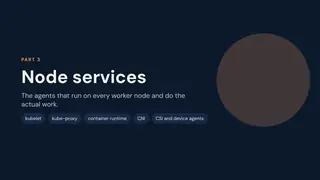</a>
<a href="media/slide-21.webp" title="Slide 21: kubelet 1 of 2: Find it on each node">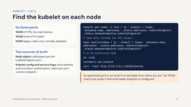</a>
<a href="media/slide-22.webp" title="Slide 22: kubelet 2 of 2: Configuration and diagnostic reads">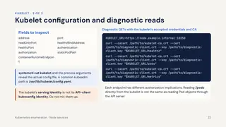</a>
<a href="media/slide-23.webp" title="Slide 23: kube-proxy 1 of 2: Find it">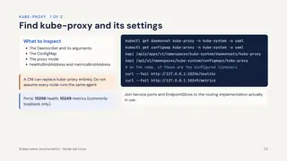</a>
<a href="media/slide-24.webp" title="Slide 24: kube-proxy 2 of 2: Intended mode versus the real dataplane">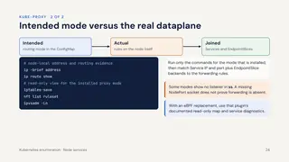</a>
<a href="media/slide-25.webp" title="Slide 25: Container runtime and CRI">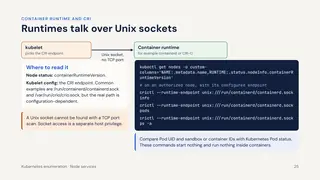</a>
<a href="media/slide-26.webp" title="Slide 26: CNI agents">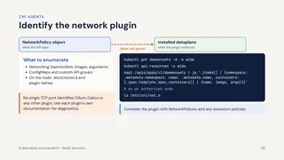</a>
<a href="media/slide-27.webp" title="Slide 27: CSI, device plugins and node agents">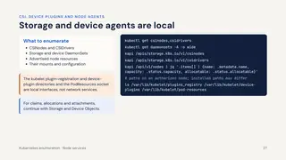</a>
<a href="media/slide-28.webp" title="Slide 28: Part 4: Shared add-ons">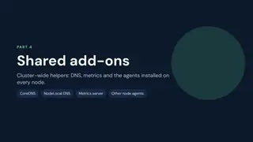</a>
<a href="media/slide-29.webp" title="Slide 29: CoreDNS: enumerate cluster DNS">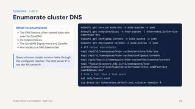</a>
<a href="media/slide-30.webp" title="Slide 30: CoreDNS: optional diagnostic ports">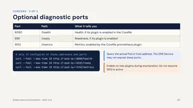</a>
<a href="media/slide-31.webp" title="Slide 31: NodeLocal DNSCache">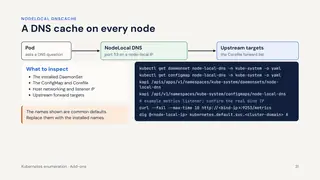</a>
<a href="media/slide-32.webp" title="Slide 32: Metrics server: reached through the API server">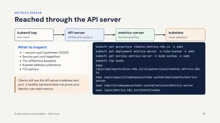</a>
<a href="media/slide-33.webp" title="Slide 33: Other installed node agents">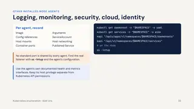</a>
<a href="media/slide-34.webp" title="Slide 34: The enumeration workflow">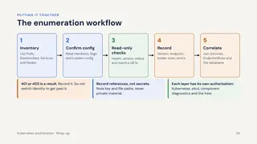</a>
<a href="media/slide-35.webp" title="Slide 35: Port quick reference">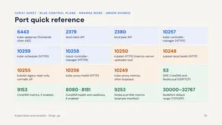</a>
<a href="media/slide-36.webp" title="Slide 36: Six key takeaways">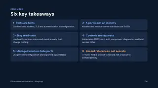</a>
</div>

<%= render("../../_partials/post-footer.html", { title, url }) %>
